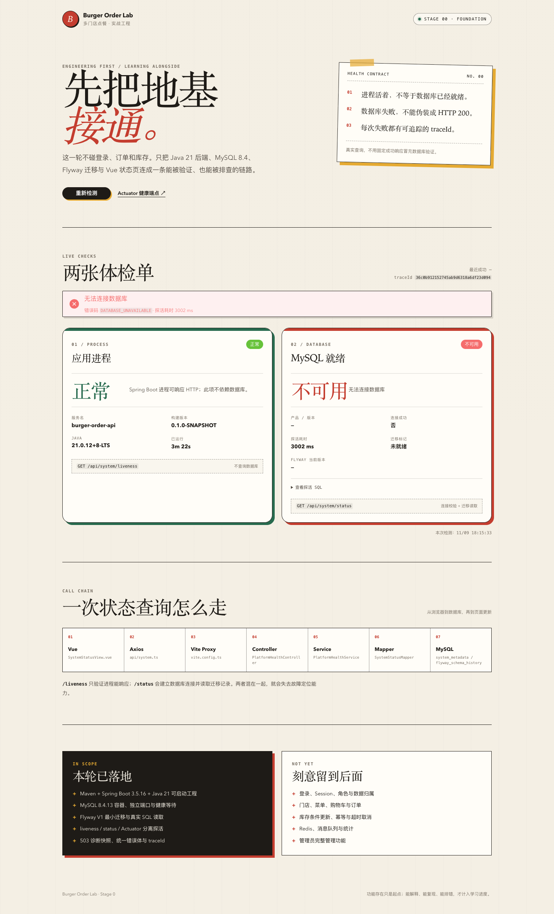
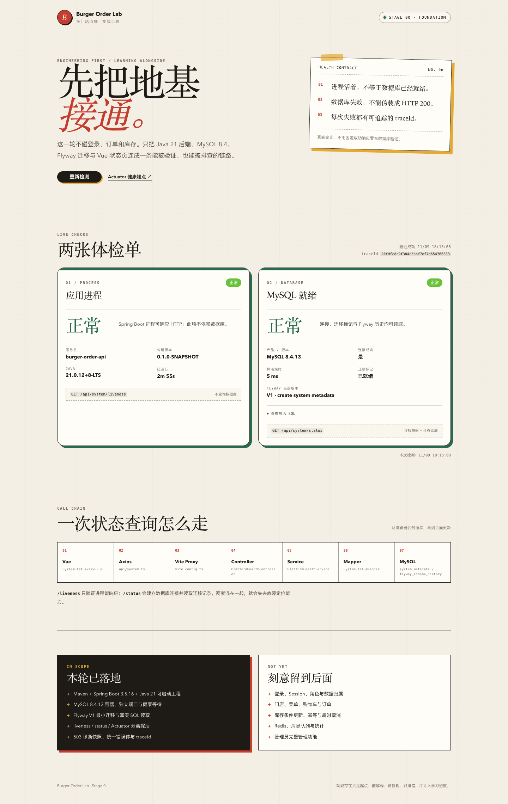
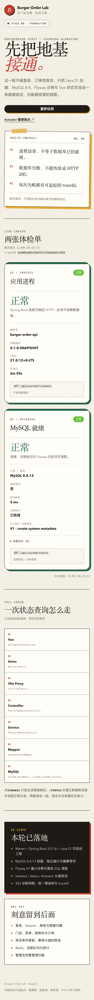

# 阶段 0 实际验证记录

验证时间：2026-11-09 18:05–18:16（Asia/Shanghai）
工程目录：`/Users/unravel/hamburgOrder`
结论范围：只对应本机实际执行结果，不代表生产验证。

> 历史说明：A2 后 Actuator 只暴露 `/actuator/health/**`；本页仍保留阶段 0 当时的三个暴露端点记录。

## 1. 环境

| 项目 | 实际值 |
| --- | --- |
| OS | macOS 27.2 / arm64 |
| JDK（构建与测试显式使用） | OpenJDK 21.0.12 |
| Maven | 3.9.16 |
| Node.js | 24.18.0 |
| pnpm | 12.11.2 |
| Docker client | 29.9.1 |
| Docker server | 29.5.2（Colima / Ubuntu 24.04） |
| MySQL | 8.4.13（`mysql:8.4.13`） |
| Spring Boot | 3.5.16 |
| MyBatis-Plus | 3.5.18 |
| Flyway | 11.20.3（覆盖 Boot 默认的 11.7.2） |
| 浏览器验证 | Google Chrome 156.0.8078.81，Playwright CLI 1.58.2 调用系统 Chrome |

环境注意：

- 本机 Maven 默认可能选择 Java 26。本轮的后端构建与测试显式设置 `JAVA_HOME` 为 Java 21，测试日志确认 `Java 21.0.12`。
- `maven-enforcer-plugin` 已锁定 Java `[21,22)` 与 Maven `[3.9,)`。用默认 JDK 26 执行 `mvn validate` 实际返回 BUILD FAILURE，并给出 “This project is locked to Java 21”；切到 Java 21 后测试通过。
- 本机 Docker 使用 Colima 非默认 socket。Testcontainers 运行命令显式设置：
  - `DOCKER_HOST=unix://$HOME/.colima/default/docker.sock`
  - `TESTCONTAINERS_DOCKER_SOCKET_OVERRIDE=/var/run/docker.sock`
- 后端 Maven 依赖在本次沙箱中写入项目内 `.m2/repository`；POM 没有依赖这个路径，正常终端可直接使用默认 `~/.m2`。

## 2. 数据库启动与参数

命令：

```bash
./scripts/db-up.sh
```

实际结果：

```text
burger-order-lab-mysql-1   mysql:8.4.13   Up (healthy)   127.0.0.1:13306->3306/tcp
```

SQL 参数：

```text
version          8.4.13
character_set    utf8mb4
collation        utf8mb4_0900_ai_ci
time_zone        +00:00
```

## 3. 迁移与数据

Flyway 启动日志：

```text
Database: jdbc:mysql://localhost:32771/burger_order (MySQL 8.4)
Successfully validated 1 migration
Migrating schema `burger_order` to version "1 - create system metadata"
Successfully applied 1 migration to schema `burger_order`, now at version v1
```

最终数据库状态：

```text
system_metadata:
schema_ready    1    2026-11-09 10:12:14.314

flyway_schema_history:
installed_rank=1  version=1  description=create system metadata  type=SQL  success=1
```

数据量：1 张业务可见表、1 行 marker、1 条成功迁移。阶段 0 没有订单/库存数据。

## 4. 后端测试

命令（测试在 Java 21 下执行）：

```bash
JAVA_HOME="$(/usr/libexec/java_home -v 21)" \
DOCKER_HOST="unix://$HOME/.colima/default/docker.sock" \
TESTCONTAINERS_DOCKER_SOCKET_OVERRIDE="/var/run/docker.sock" \
mvn -f backend/pom.xml test
```

实际结果（最终一轮，已加入 Java 21 Enforcer）：

```text
PlatformHealthControllerTest:  3 tests, 0 failures, 0 errors, 0 skipped
PlatformHealthIntegrationTest: 3 tests, 0 failures, 0 errors, 0 skipped
BUILD SUCCESS
```

拆分：

| 测试类 | 用例数 | 内容 |
| --- | --- | --- |
| `PlatformHealthControllerTest` | 3 | traceId、503 降级快照、500 不泄露内部细节 |
| `PlatformHealthIntegrationTest` | 3 | 真实 MySQL 容器、Flyway、HTTP 状态、Actuator |

集成测试实际启动：

```text
Container mysql:8.4.13 started
JDBC URL: jdbc:mysql://localhost:32771/burger_order
Flyway 11.20.3
No "MySQL 8.4 is newer than this version of Flyway" warning
```

第一次测试曾因 Testcontainers 找不到 Colima socket 而 `Skipped: 3`。这没有被当作通过；修正 socket 后重新执行，上表是最终结果，且集成测试已去掉“无 Docker 自动跳过”。

## 5. 前端检查

命令：

```bash
cd frontend
pnpm typecheck
pnpm test
pnpm build
```

实际结果：

```text
vue-tsc --noEmit                    成功
Vitest: 4 tests passed              store 成功/网络失败/500/traceId 降级时间语义
Vite build                          成功
```

产物（按需引入 Element Plus 后）：

```text
dist/assets/index-*.css         38.89 kB
dist/assets/index-*.js         150.46 kB
dist/assets/SystemStatusView   70.85 kB JS + 11.63 kB CSS
```

首次构建使用 Element Plus 全量注册，JS 约 1,026 kB；改为显式组件与样式导入后降到约 150 kB。这是实际发现的工程问题，不是预先编造。

## 6. 运行时探活

### 正常状态

```bash
curl -i http://127.0.0.1:8080/api/system/liveness
curl -i http://127.0.0.1:8080/api/system/status
curl -i http://127.0.0.1:5173/api/system/status
```

结果：

| 端点 | HTTP | 关键字段 |
| --- | --- | --- |
| `/api/system/liveness` | 200 | `status=UP`, Java 21.0.12 |
| `/api/system/status` | 200 | `database.status=UP`, `version=8.4.13`, `schemaReady=true`, `flywayVersion=1` |
| Vite `/api/system/status` | 200 | 同样返回，证明代理链路可用 |

Actuator：

```text
/actuator/health/liveness   HTTP 200 {"status":"UP"}
/actuator/health/readiness  HTTP 200 {"status":"UP"}
```

### 故障状态：停止 MySQL，保持后端进程

执行：

```bash
docker compose --env-file .env -f deploy/compose.yaml stop mysql
```

实际结果：

| 端点 | HTTP | 结果 |
| --- | --- | --- |
| `/api/system/liveness` | 200 | 应用仍为 UP，证明不依赖数据库 |
| `/api/system/status` | 503 | `status=DOWN`, `connected=false`, `code=DATABASE_UNAVAILABLE`, `latencyMs=3013` |
| `/actuator/health/readiness` | 503 | `{"status":"DOWN"}` |

页面截图（等待真实 503 告警出现后才拍摄）：



恢复：

```bash
docker compose --env-file .env -f deploy/compose.yaml up -d --wait
```

恢复后：

```text
/api/system/status           HTTP 200  status=UP
/actuator/health/readiness   HTTP 200  status=UP
```

这组对照是本轮最关键的验收证据：MySQL 进程与 Spring Boot 进程被分别验证，503 也没有被包装成 200。

## 7. 页面渲染

### 桌面 1440px



### 窄屏 390px



说明：

- 使用系统 Chrome、Playwright CLI 的 `screenshot` 命令，只做只读页面验证。
- 390px 是浏览器视口，不是物理手机实机测试。
- 页面通过 Vite 代理读取真实后端；截图中的 MySQL 版本、Flyway 版本和 traceId 来自实际响应。

## 8. OpenAPI 校验

命令：

```bash
npx @redocly/cli@2.20.0 lint docs/api/openapi.yaml
```

实际结果：

```text
docs/api/openapi.yaml: validated in 20ms
Your API description is valid.
```

结果为“有效”，同时有 5 条风格 warning：缺少 `license` 字段，以及 4 个 GET 路径没有声明 4XX 响应。它们是规范建议，不是 YAML/结构错误，本轮保留；不把“有 warning”写成“零问题”。

## 9. 实际、预期与未验证

### 已实测且符合预期

- Java 21 下后端可构建、可测试、可启动。
- Flyway 11.20.3 + MySQL 8.4.13 可迁移，无 Flyway 版本过旧 warning。
- liveness、status、readiness 的 200/503 行为符合契约。
- 停止/恢复 MySQL 时，进程状态与数据库状态可分离观察。
- Vue 页面可加载真实数据，桌面和窄屏布局可用。
- 503 响应体仍保留完整诊断快照，前端可区分后端不可达与数据库不可用。
- 统一错误体不返回堆栈与 SQL；traceId 可关联日志。

### 尚未验证

- 登录、Session Cookie、CSRF、角色与数据归属。
- 订单、库存、优惠券、金额精度与事务并发。
- 多实例部署、数据库主从/故障切换。
- 生产 TLS、密钥管理、日志脱敏、限流。
- Safari、Firefox、物理移动设备。
- 性能与容量指标。
- 业务 SQL 的索引与 `EXPLAIN`：阶段 0 没有业务查询，不能伪造执行计划。

### 已知环境注意事项

- Maven 直接运行时可能选择 Java 26；使用项目脚本或在终端设置 Java 21。
- Testcontainers 在非默认 Docker context 下需要显式 `DOCKER_HOST`，否则会失败/跳过。
- 健康接口当前公开，只适合本地开发；进入 A2 后必须重新审查暴露面。

## 10. 复现命令汇总

```bash
# 环境
cp .env.example .env
./scripts/db-up.sh

# 后端
JAVA_HOME="$(/usr/libexec/java_home -v 21)" ./scripts/run-backend.sh

# 前端
cd frontend
pnpm install
pnpm dev

# 验证
./scripts/verify-stage0.sh

# 测试
JAVA_HOME="$(/usr/libexec/java_home -v 21)" \
DOCKER_HOST="unix://$HOME/.colima/default/docker.sock" \
TESTCONTAINERS_DOCKER_SOCKET_OVERRIDE="/var/run/docker.sock" \
mvn -f backend/pom.xml test

cd frontend
pnpm typecheck && pnpm test && pnpm build
```
