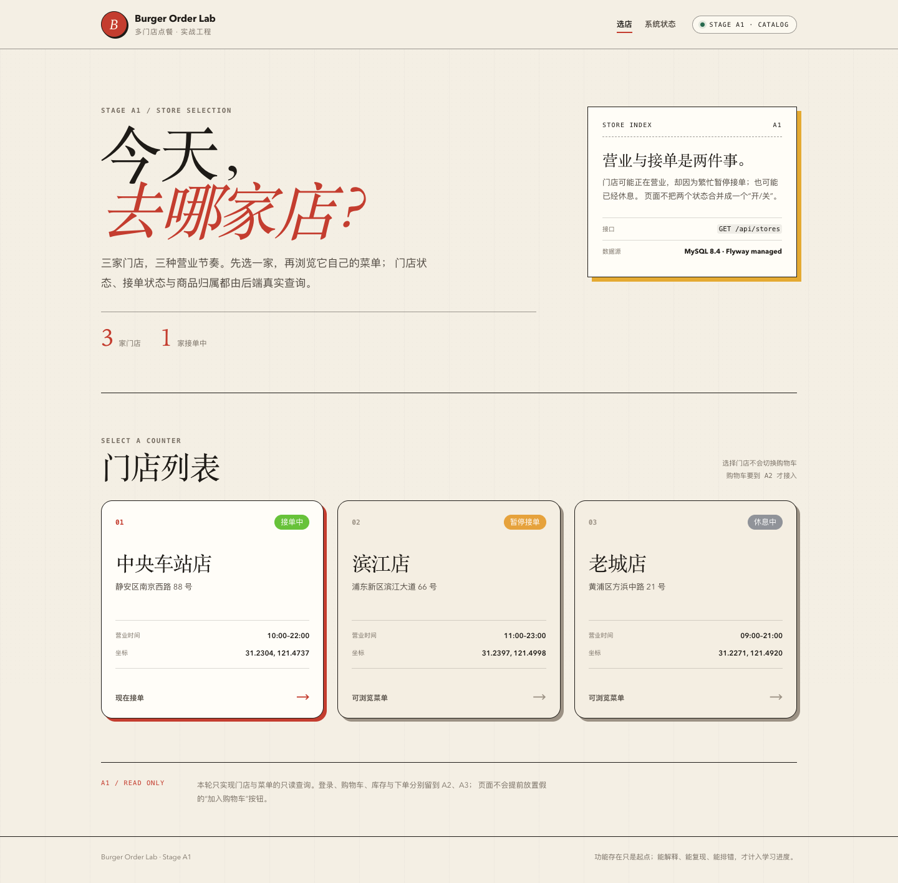
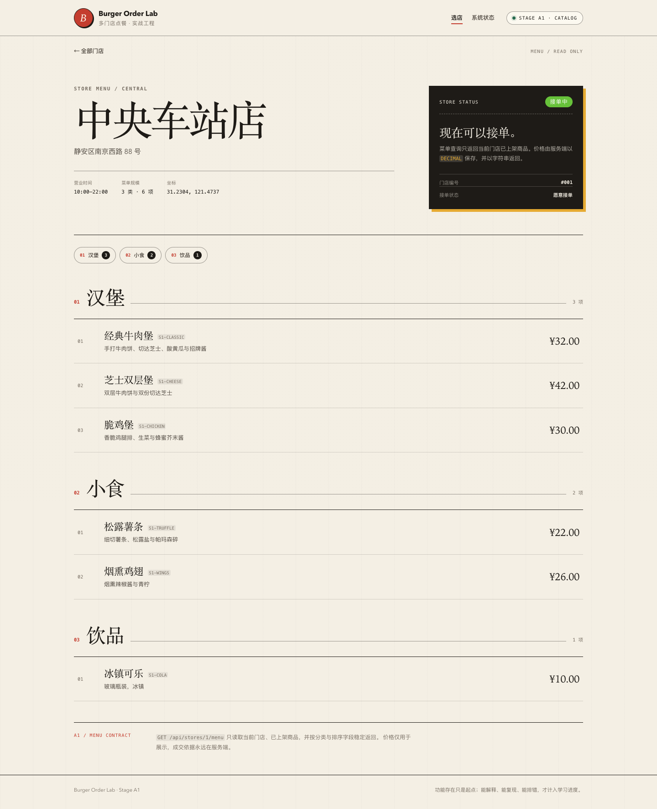
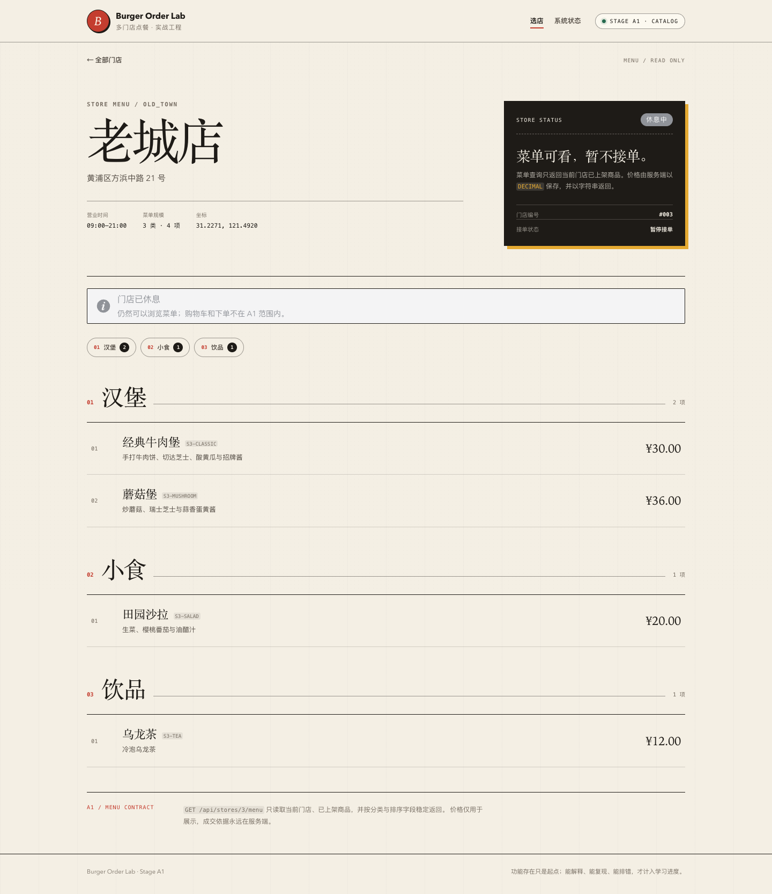
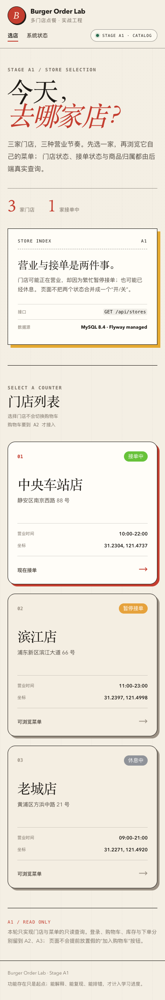
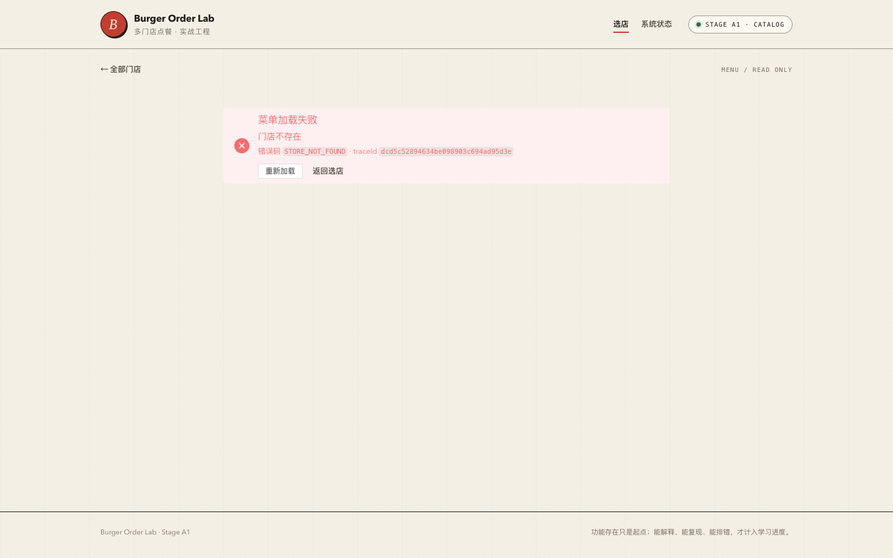
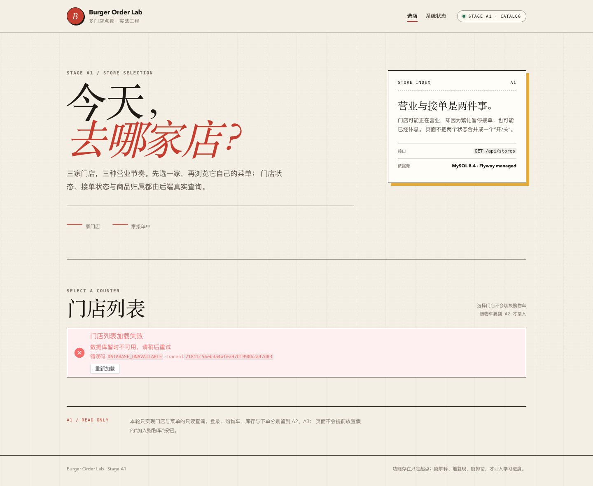
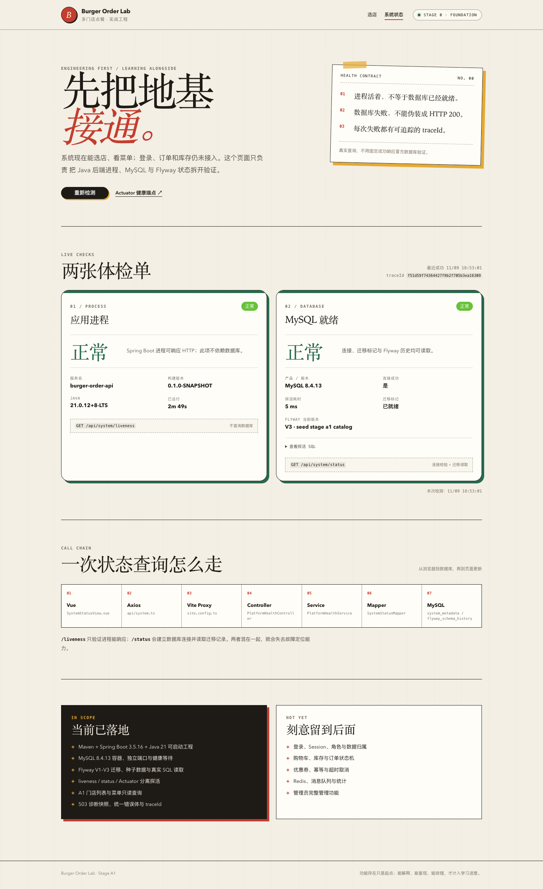

# 阶段 A1 实际验证记录

验证时间：2026-11-09 18:35–18:48（Asia/Shanghai）
范围：门店/菜单只读查询、种子数据、Vue 页面。
只记录本机实际结果，不代表生产验证。

## 1. 环境

沿用阶段 0：

- macOS 27.2 / arm64
- OpenJDK 21.0.12（Maven 显式使用）
- Maven 3.9.16
- Node.js 24.18.0 / pnpm 12.11.2
- Docker 29.9.1，Colima server 29.5.2
- MySQL 8.4.13
- Spring Boot 3.5.16 / MyBatis-Plus 3.5.18 / Flyway 11.20.3

Testcontainers 需要：

```bash
DOCKER_HOST="unix://$HOME/.colima/default/docker.sock"
TESTCONTAINERS_DOCKER_SOCKET_OVERRIDE="/var/run/docker.sock"
```

## 2. 迁移与数据

实际 Flyway 应用：

```text
Successfully applied 3 migrations
Migrating schema to version "1 - create system metadata"
Migrating schema to version "2 - create store catalog"
Migrating schema to version "3 - seed stage a1 catalog"
now at version v3
```

实际数据：

| 门店 | 营业 | 接单 | 总商品 | 在售 |
| --- | --- | --- | --- | --- |
| 中央车站店 | OPEN | 1 | 7 | 6 |
| 滨江店 | OPEN | 0 | 6 | 6 |
| 老城店 | CLOSED | 0 | 5 | 4 |

合计 3 家门店、18 个商品、16 个在售。中央车站店下架商品“海盐奶昔”未出现在菜单。

## 3. 菜单索引执行计划

SQL：

```sql
SELECT id, store_id, product_code, name, description, category_code,
       category_name, category_sort, price, on_sale, sort_order
FROM products
WHERE store_id = 1 AND on_sale = 1
ORDER BY category_sort, sort_order, id;
```

实际 `EXPLAIN`：

```text
type=ref
possible_keys=uk_products_store_code,idx_products_store_menu
key=idx_products_store_menu
key_len=9
ref=const,const
rows=6
Extra=NULL
```

结论：

- 使用 `idx_products_store_menu`；
- `key_len=9` 对应 `BIGINT(8) + TINYINT(1)`；
- 未出现 filesort；
- 预估扫描 6 行，与中央车站店在售商品数一致。

限制：数据量很小，这只是一次结构验证，不代表大表或分页场景的性能结论。

## 4. 后端测试

命令：

```bash
JAVA_HOME="$(/usr/libexec/java_home -v 21)" \
DOCKER_HOST="unix://$HOME/.colima/default/docker.sock" \
TESTCONTAINERS_DOCKER_SOCKET_OVERRIDE="/var/run/docker.sock" \
mvn -f backend/pom.xml test
```

最终结果：

| 测试类 | 数量 | 结果 |
| --- | --- | --- |
| `PlatformHealthControllerTest` | 3 | 通过 |
| `PlatformHealthIntegrationTest` | 3 | 通过 |
| `StoreCatalogIntegrationTest` | 5 | 通过 |
| `StoreControllerErrorTest` | 2 | 通过（错误映射，使用 mock；真实停库另做手工验证） |
| 合计 | 13 | 0 failures, 0 errors, 0 skipped |

A1 实际经历的错误：

1. 集成测试首次运行有 5 个失败，原因都是端点尚未实现（404）。
2. 实现后 `/api/stores/abc` 虽然返回 400，但响应体没有 `INVALID_PARAMETER`。根因是 ProblemDetails advice 抢先处理参数转换异常；关闭未使用的 `spring.mvc.problemdetails` 并提高自定义 advice 优先级后通过。
3. 手动停库验证时，`/api/stores` 返回 500。根因是事务开启失败抛出 `CannotCreateTransactionException`，被通用异常处理器接管。先补两个失败测试，再把 `CannotCreateTransactionException` 与 `DataAccessResourceFailureException` 映射为 503 `DATABASE_UNAVAILABLE`。
4. `TINYINT(1)` 在 MySQL 8.4 触发显示宽度弃用告警，迁移改为无宽度 `TINYINT`。
5. 门店列表加载失败时，头部统计显示“0 家门店”，容易被误读为“真的没有门店”；改为 `—`，并用停库截图确认。


## 5. 前端测试与构建

命令：

```bash
cd frontend
pnpm typecheck
pnpm test
pnpm build
```

结果：

```text
Vitest: 12 tests passed
  systemStatus 4
  storeList 2
  storeMenu 3
  formatPrice 3
vue-tsc: 通过
Vite build: 通过
```

构建产物（A1）：

```text
index-*.js              158.10 kB
http-*.js                58.45 kB
StoreListView-*.js        5.16 kB
StoreMenuView-*.js        6.13 kB
SystemStatusView-*.js    11.67 kB
```

页面按路由懒加载，Element Plus 继续按需引入。

## 6. HTTP 实测

### 门店列表

```text
GET /api/stores -> HTTP 200
3 stores: 中央车站店, 滨江店, 老城店
```

Vite 代理：

```text
GET http://127.0.0.1:5173/api/stores -> HTTP 200
```

### 数据库掉线

```text
GET /api/stores (MySQL stopped)
HTTP 503
code=DATABASE_UNAVAILABLE
message=数据库暂时不可用，请稍后重试

MySQL 恢复后：
GET /api/stores -> HTTP 200，3 家门店
```

### 错误语义

```text
GET /api/stores/999
HTTP 404  STORE_NOT_FOUND  门店不存在

GET /api/stores/999/menu
HTTP 404  STORE_NOT_FOUND  门店不存在

GET /api/stores/abc
HTTP 400  INVALID_PARAMETER  请求参数格式不正确
```

三个响应都带 `traceId`。

### 菜单

```text
store 1 中央车站店 OPEN orderable=true
  BURGER=3, SIDE=2, DRINK=1

store 2 滨江店 OPEN orderable=false
  BURGER=2, SIDE=2, DRINK=2

store 3 老城店 CLOSED orderable=false
  BURGER=2, SIDE=1, DRINK=1
```

价格实际返回：

```json
{"price":"32.00"}
```

不是 JSON number。

## 7. 页面渲染

### 门店列表



### 正常营业门店菜单



### 休息中门店菜单



### 窄屏 390px



### 未知门店错误页



### 数据库不可用



加载失败时头部统计显示 `—`，而不是误导性的“0 家门店”；告警保留 `DATABASE_UNAVAILABLE` 与 traceId。MySQL 恢复后 `/api/stores` 回到 200。

### 系统状态页仍可用



阶段 0 的 liveness/status 页面保留在 `/system`，共享导航后仍能真实读取到 Flyway V3。

说明：

- 使用系统 Chrome 156 + Playwright CLI 1.58.2，只读截图；
- 390px 是浏览器视口，不是物理手机实机；
- 404 截图在真实 404 响应后拍摄。

## 8. OpenAPI

```bash
npx @redocly/cli@2.20.0 lint docs/api/openapi.yaml
```

结果：结构有效。有 6 条风格 warning，主要是缺少 `license` 与部分无参数 GET/Actuator 端点未声明 4XX。它们没有阻止契约校验，但仍是待收敛项，不写成“零问题”。

## 9. 已验证与未验证

### 已实测符合预期

- 3 家门店与两种非接单原因分别展示；
- 菜单按门店隔离，只返回在售商品；
- 分类与商品排序稳定；
- 价格以十进制字符串返回；
- 门店 404、非法 ID 400 使用统一错误体；
- 前端切换门店时丢弃过期响应；
- 菜单页对休息中门店展示提示但仍允许浏览。

### 尚未验证

- 登录、Session、CSRF、角色与门店数据权限；
- 购物车、库存、订单、支付；
- 管理端门店/商品写入；
- 大量门店/商品的分页与查询性能；
- Safari、Firefox、物理移动设备；
- 生产缓存、限流、监控与安全加固。

## 10. 复现

```bash
./scripts/db-up.sh
JAVA_HOME="$(/usr/libexec/java_home -v 21)" ./scripts/run-backend.sh
cd frontend && pnpm dev

./scripts/verify-stage-a1.sh

curl -s http://127.0.0.1:8080/api/stores | python3 -m json.tool
curl -s http://127.0.0.1:8080/api/stores/1/menu | python3 -m json.tool
curl -i http://127.0.0.1:8080/api/stores/999
curl -i http://127.0.0.1:8080/api/stores/abc
```
