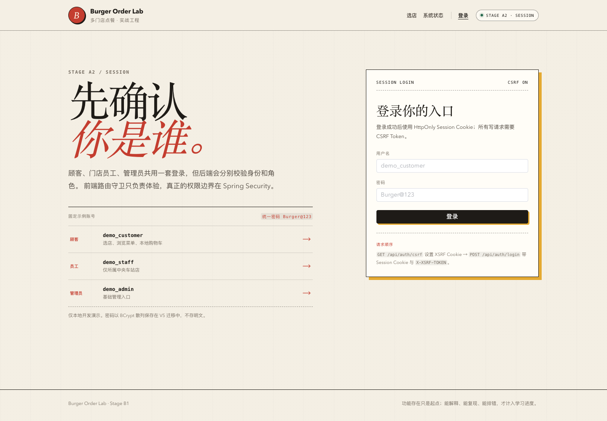
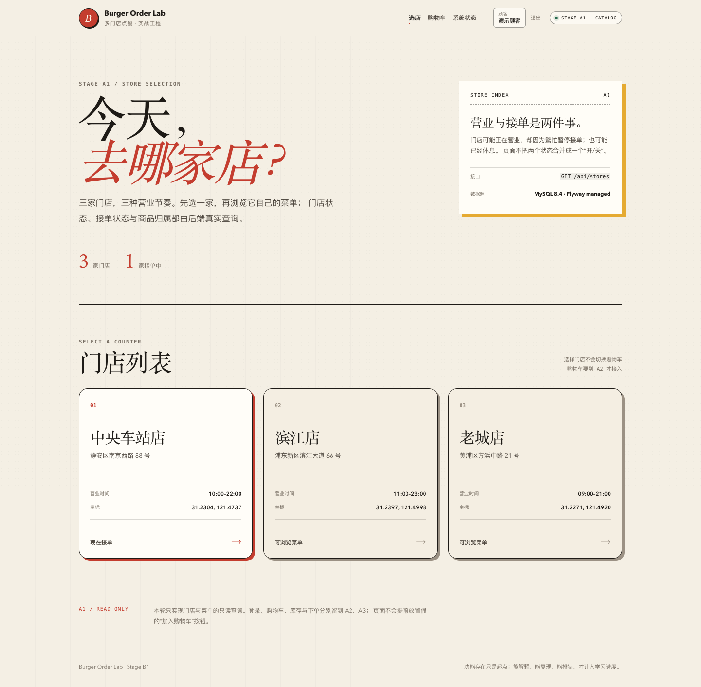
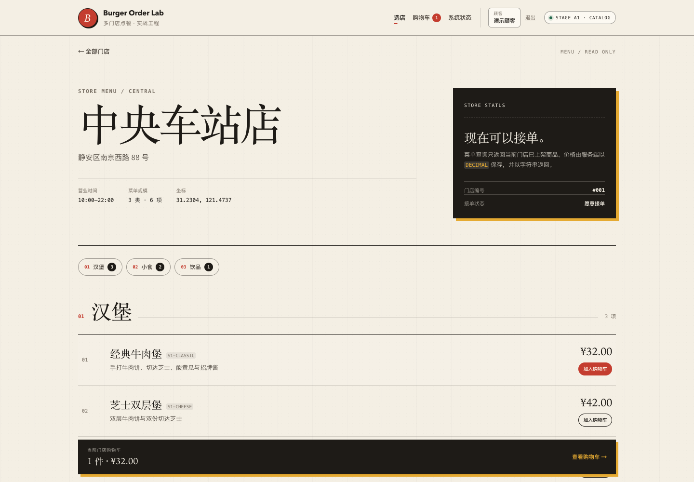
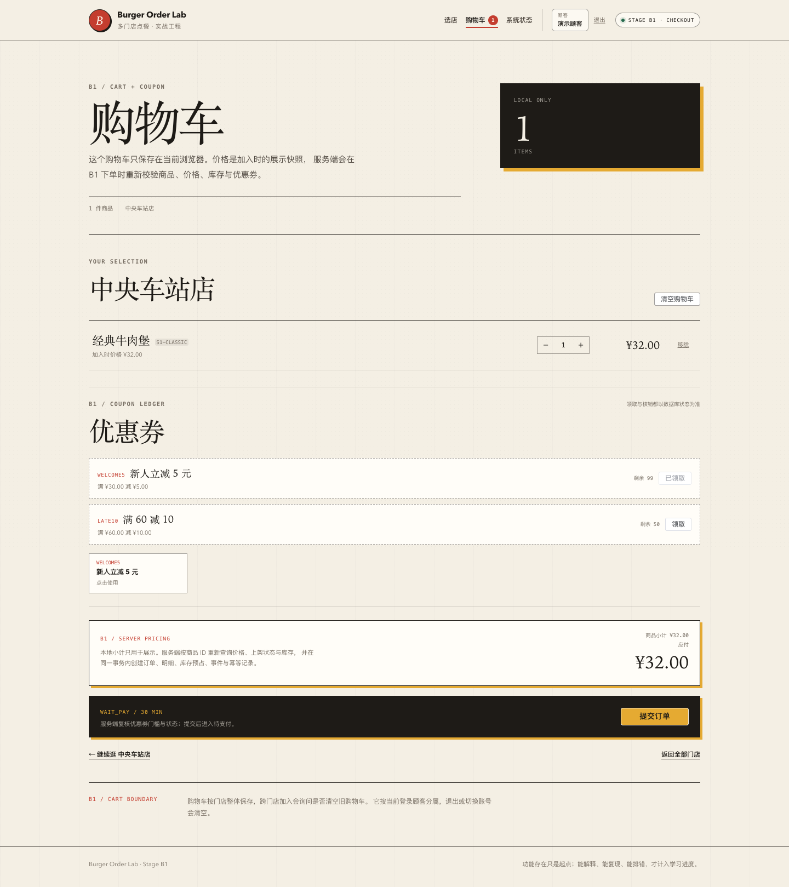
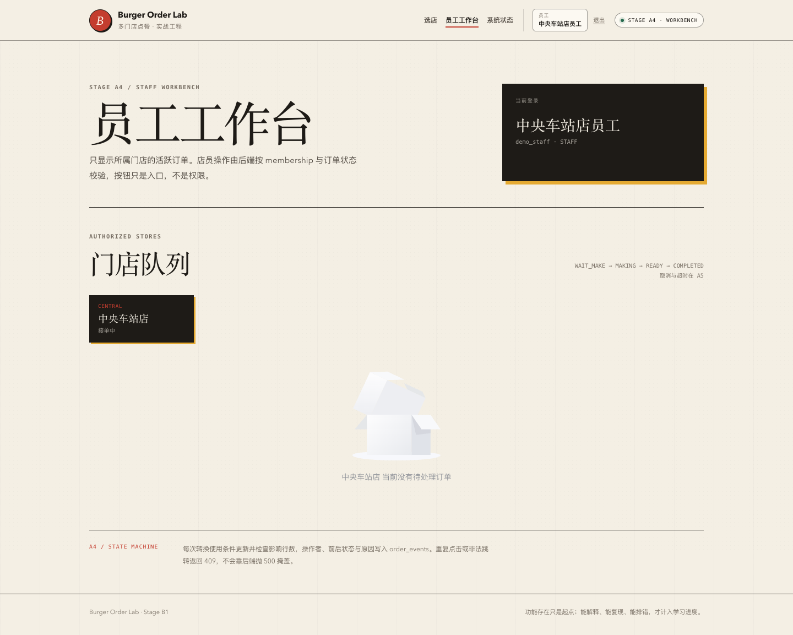
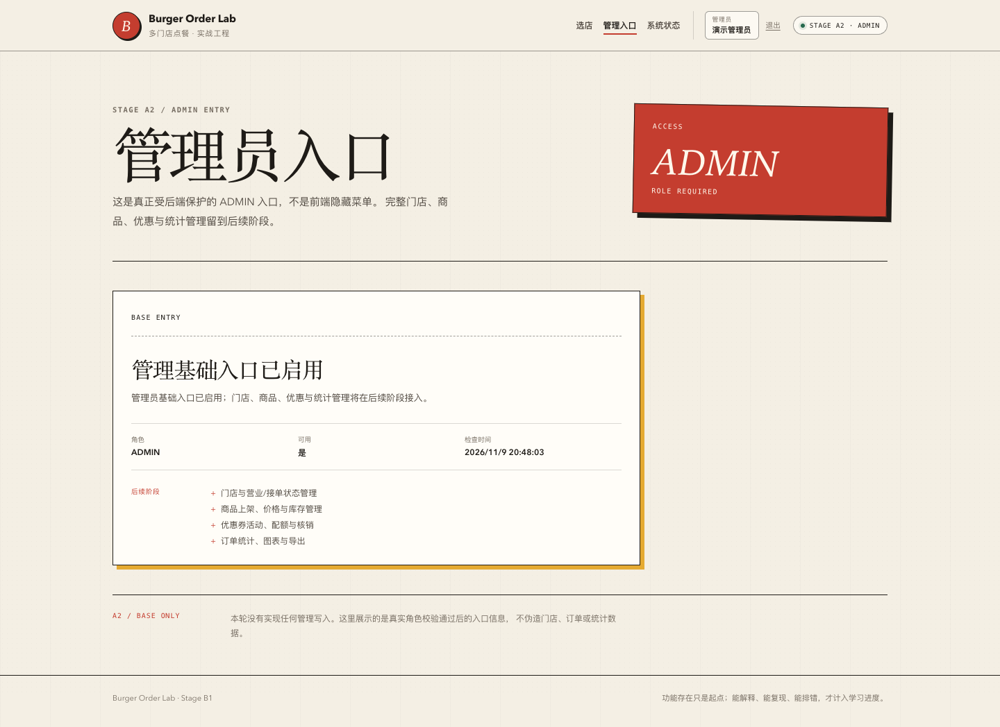

# 阶段 A2 实际验证记录

验证时间：2026-11-09 19:16–19:35（Asia/Shanghai）
范围：固定账号、Session、CSRF、角色入口、员工门店范围、本地购物车。
只对应本机实际结果，不代表生产验证。

## 1. 环境

- macOS 27.2 / arm64
- OpenJDK 21.0.12（Maven 显式使用）
- Maven 3.9.16
- Node.js 24.18.0 / pnpm 12.11.2
- Docker 29.9.1，Colima server 29.5.2
- MySQL 8.4.13
- Spring Boot 3.5.16 / Spring Security 6.5.11（Boot BOM）
- Playwright 1.58.2 + 本机 Chrome 156

## 2. 迁移与账号

实际 Flyway：

```text
Successfully validated 5 migrations
Migrating to version "4 - create auth tables"
Migrating to version "5 - seed stage a2 auth users"
now at version v5
```

实际数据库：

```text
id=1 demo_customer CUSTOMER enabled=1 hash=$2y$12$
id=2 demo_staff    STAFF    enabled=1 hash=$2y$12$
id=3 demo_admin    ADMIN    enabled=1 hash=$2y$12$

membership: user_id=2 -> store_id=1
```

明文密码未存入数据库；统一演示密码 `Burger@123` 仅用于本地。

## 3. 后端测试

最终结果：

| 测试类 | 数量 | 内容 |
| --- | --- | --- |
| `AuthSessionIntegrationTest` | 7 | 真实 Tomcat + MySQL、BCrypt、Session、CSRF、401/403、员工范围、登出 |
| `StoreCatalogIntegrationTest` | 5 | 公开门店/菜单回归 |
| `PlatformHealthIntegrationTest` | 3 | 健康/Actuator |
| `PlatformHealthControllerTest` | 3 | 健康错误体 |
| `StoreControllerErrorTest` | 2 | 数据库故障 503 |
| 合计 | **20** | 0 failures, 0 errors, 0 skipped |

Auth 测试实际覆盖：

- 未登录 `/api/auth/me` → 401；
- 顾客登录 → Session Cookie，`/me` 200；
- 顾客访问 staff/admin → 403；
- 员工工作区只返回门店 1；
- 管理员入口 200，员工入口 403；
- 登出 → 204，之后 `/me` 401；
- 无 CSRF 登录 → 403 `CSRF_INVALID`；
- 错误密码 → 401 `INVALID_CREDENTIALS`，响应不含密码；
- 空用户名/密码 → 400 `INVALID_REQUEST`（curl 手工验证，未加入自动化计数）。

## 4. 实际 Cookie

`GET /api/auth/csrf`：

```text
HTTP/1.1 200
set-cookie: XSRF-TOKEN=d775...; Path=/; SameSite=Lax
cache-control: no-store
```

`POST /api/auth/login`：

```text
HTTP/1.1 200
set-cookie: BURGER_SESSION=...; Path=/; HttpOnly; SameSite=Lax
{"id":1,"username":"demo_customer","displayName":"演示顾客","role":"CUSTOMER"}
```

会话后：

```text
GET /api/auth/me         200 CUSTOMER
GET /api/staff/workspace 403 FORBIDDEN
GET /api/admin/entry     403 FORBIDDEN
```

- CSRF Cookie 无 HttpOnly，前端 Axios 必须读取。
- Session Cookie HttpOnly。
- 本地 `Secure` 未启用；生产必须 HTTPS + Secure。

## 5. 前端测试

```text
Vitest: 21 tests passed
  auth 4
  cart 5
  storeList 2
  storeMenu 3
  systemStatus 4
  formatPrice 3
```

`vue-tsc` 通过；Vite build 通过。

构建产物（A2，按路由懒加载）：

```text
index-*.js            131.09 kB
http-*.js              58.63 kB
StoreMenuView-*.js     15.38 kB
LoginView-*.js          3.84 kB
CartView-*.js           3.69 kB
StaffWorkspaceView      3.44 kB
AdminEntryView          2.80 kB
```

## 6. Playwright 真实浏览器 smoke

命令：

```bash
cd frontend
pnpm test:e2e
```

实际通过：

```text
A2 browser smoke passed: customer login + CSRF + cart + staff/admin role entries
```

覆盖：

1. 打开登录页并截图；
2. 顾客填写账号密码，经真实 CSRF 登录；
3. 进入中央车站店，加入经典牛肉堡；
4. Header 购物车计数变为 1；
5. 进入购物车，小计 `¥32.00`；
6. 从门店 1 切到门店 2 加购，弹出跨店确认；取消后保留原购物车，再确认后清空并切换到门店 2；
7. 顾客访问 `/staff` 被前端守卫重定向；
8. 登出后购物车计数消失、localStorage 清空；
9. 员工登录，只显示中央车站店；访问 `/admin` 被重定向；
10. 管理员登录，显示基础入口；访问 `/staff` 被重定向；
11. 页面无未捕获 JS 异常。

## 7. 页面截图

> 截图说明：B1 回归时重新执行了 A2 E2E，因此页脚显示 Stage B1，购物车页已有下单按钮，员工页已变成工作台。A2 当时没有下单接口与工作台，本页测试数量和功能边界仍按 A2 历史记录。

### 登录页



### 顾客登录后首页



### 顾客菜单与购物车条



### 购物车



### 员工入口



### 管理员入口



## 8. OpenAPI

```bash
npx @redocly/cli@2.20.0 lint docs/api/openapi.yaml
```

结果：结构有效，7 条风格 warning（license、部分无参 GET 的 4XX 建议等）。不宣称零 warning。

## 9. 实际发现并修复的问题

1. 加入 Spring Security 后，`@WebMvcTest` 切片默认应用安全过滤器，旧控制器测试被 401。切片改为 `addFilters=false`，安全行为由真实 HTTP 集成测试覆盖。
2. 禁用全部切片过滤器后，traceId 断言不再适用；把 traceId 验证移到真实 Tomcat 的 401 集成测试和健康集成测试。
3. JSON 登录若只 `SecurityContextHolder.setContext` 不会自动持久化；显式调用 Session fixation 策略与 `SecurityContextRepository.saveContext`。
4. 前端登录前必须获得 CSRF Cookie；Playwright 真实流程验证 Axios 的 Cookie/Header 联动，而不是只依赖后端 curl。

## 10. 已验证与未验证

### 已实测符合预期

- 固定账号 BCrypt 登录；
- Session Cookie 与 CSRF Cookie 属性；
- 无 CSRF 写请求 403；
- 角色 401/403；
- 员工 membership 数据范围；
- 登出失效；
- 本地购物车按门店/用户隔离、持久化、跨店冲突、登出清空；
- 真实浏览器登录、加购、角色跳转。

### 尚未验证

- 登录限流、失败锁定、MFA；
- 集中式 Session、多实例；
- HTTPS/Secure Cookie、生产密钥；
- CSRF 攻击面的独立安全测试；
- 注册、密码重置；
- 订单/库存/支付；
- 并发登录和 Session 固定攻击自动化测试。

## 11. 复现

```bash
./scripts/db-up.sh
JAVA_HOME="$(/usr/libexec/java_home -v 21)" ./scripts/run-backend.sh
cd frontend && pnpm dev

cd frontend && pnpm test:e2e
```
