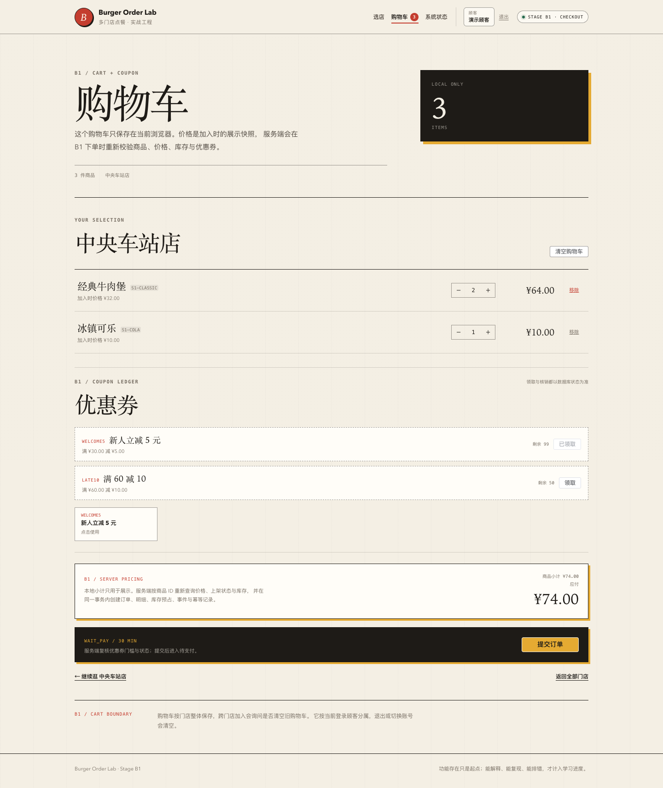
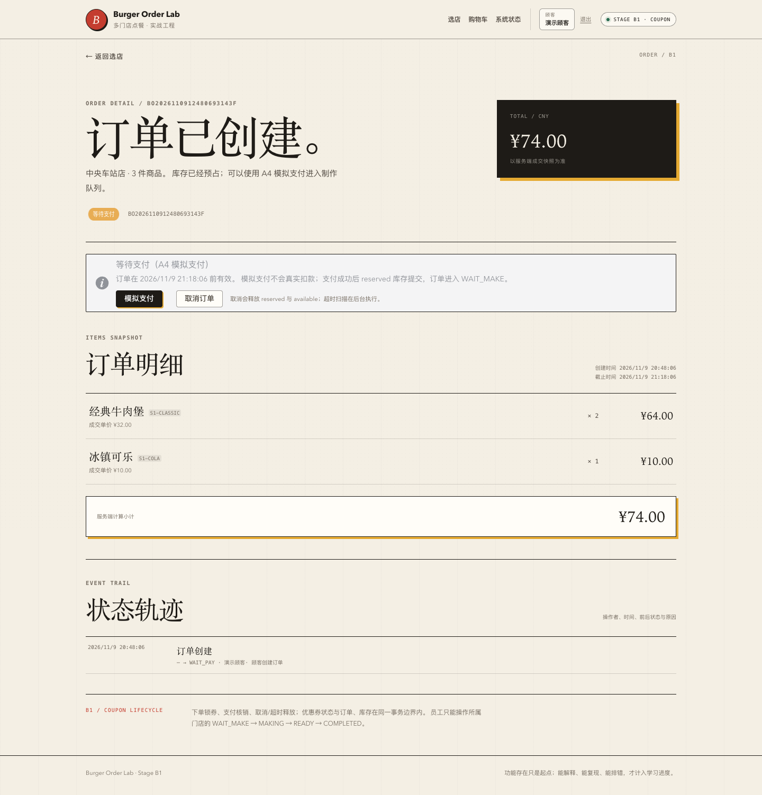

# 阶段 A3 实际验证记录

验证时间：2026-11-09 19:44–20:00（Asia/Shanghai）
范围：下单、库存预占、幂等、订单详情。
只对应本机实际结果，不代表生产容量。

## 1. 迁移

实际 Flyway：

```text
Successfully validated 7 migrations
Migrating to version "6 - create order inventory tables"
Migrating to version "7 - seed stage a3 inventory"
now at version v7
```

新增表：

```text
orders, order_items, order_events, stock, stock_logs, idempotency_records
```

V7 还新增第二条顾客 `demo_customer_two` 与 18 条库存种子。

## 2. 后端测试

最终结果：

| 测试类 | 数量 | 内容 |
| --- | --- | --- |
| `OrderHttpIntegrationTest` | 7 | 真实 Session/CSRF 下单、幂等重放/冲突、库存回滚、归属、角色、缺键、重复商品、暂停门店 |
| `OrderConcurrencyIntegrationTest` | 2 | 同键并发、最后 1 件库存并发 |
| `AuthSessionIntegrationTest` | 7 | A2 会话/CSRF/角色回归 |
| `StoreCatalogIntegrationTest` | 5 | A1 公开查询回归 |
| `PlatformHealthIntegrationTest` | 3 | 健康/Actuator |
| `PlatformHealthControllerTest` | 3 | 健康错误体 |
| `StoreControllerErrorTest` | 2 | 数据库故障 503 |
| 合计 | **29** | 0 failures, 0 errors, 0 skipped |

## 3. 真实订单创建与重放

手工 HTTP（真实 Session + CSRF + MySQL）：

```text
POST /api/orders
Idempotency-Key: manual-a3-key-0001
storeId=1, items=1001×2 + 1006×1

首次: HTTP 201
orderId=1, orderNo=BO202611091157037CC724
status=WAIT_PAY
totalAmount=74.00
Idempotent-Replayed=false

重放: HTTP 200
Idempotent-Replayed=true
同一个 orderId=1
```

数据库：

```text
stock 1001: available 48, reserved 2, version 1
stock 1006: available 99, reserved 1, version 1
orders: 1
idempotency_records: manual-a3-key-0001 COMPLETED order_id=1
```

后续 A3 E2E 又创建了订单 3；在采集执行计划时：

```text
orders=3, total=222.00
stock 1001: available 44, reserved 6, version 3
stock 1006: available 97, reserved 3, version 3
idempotency_records: COMPLETED=3
```

这些数字来自开发库实际状态，不是模拟指标。

## 4. 条件更新执行计划

```sql
EXPLAIN UPDATE stock
SET available = available - 1,
    reserved = reserved + 1,
    version = version + 1
WHERE store_id = 1
  AND product_id = 1001
  AND available >= 1;
```

实际：

```text
type=range
key=PRIMARY
key_len=16
ref=const,const
rows=1
Extra=Using where
```

条件更新使用 `PRIMARY (store_id, product_id)`，并且 `available >= 1` 在 UPDATE 条件内。

## 5. 并发证据

### 同 Idempotency-Key 双请求

两个线程使用同一 key 和同一 request body，经 CountDownLatch 同时放行：

```text
orders=1
order_items=1
stock_logs=1
idempotency_records=1
stock 1001: available=8, reserved=2
results: 一个 replayed=false，一个 replayed=true，同一个 orderId
```

结论：数据库唯一约束与事务共同保证只建一单，不是前端按钮防重复。

### 最后 1 件库存、不同 key 双请求

```text
初始 stock 1001: available=1, reserved=0

结果:
  1 个 CreateOrderResult 成功
  1 个 BusinessConflictException: STOCK_INSUFFICIENT
  orders=1
  stock 1001: available=0, reserved=1
  idempotency_records=1
```

结论：条件更新与影响行数检查保证最多一单成功。

### 多商品回滚

HTTP 测试设置 1006 库存为 0，请求 1001×1 + 1006×1：

```text
HTTP 409 STOCK_INSUFFICIENT
orders=0
order_items=0
stock_logs=0
idempotency_records=0
stock 1001: available=50, reserved=0
```

第二项失败使第一项的预占和已在事务中的订单数据全部回滚。

## 6. HTTP 错误与权限

| 场景 | 实际结果 |
| --- | --- |
| 缺 Idempotency-Key | 400 `IDEMPOTENCY_KEY_REQUIRED` |
| 重复商品 | 400 `DUPLICATE_ORDER_ITEM` |
| 幂等键相同、内容不同 | 409 `IDEMPOTENCY_CONFLICT` |
| 库存不足 | 409 `STOCK_INSUFFICIENT` |
| 暂停接单门店 | 409 `STORE_NOT_ORDERABLE` |
| 其他顾客读订单 | 404 `ORDER_NOT_FOUND` |
| 员工下单/读订单 | 403 `FORBIDDEN` |
| 未登录订单接口 | 401 `UNAUTHORIZED` |

## 7. 前端测试与浏览器 E2E

```text
Vitest: 24 tests passed
  auth 4
  cart 5
  checkout 3
  storeList 2
  storeMenu 3
  systemStatus 4
  formatPrice 3
```

A3 Playwright：

```text
A3 browser smoke passed: cart -> order 3 -> reload -> auth redirect
```

覆盖：

1. 顾客登录；
2. 中央车站店加购经典牛肉堡 ×2 + 可乐 ×1；
3. 购物车服务端契约展示；
4. 点击提交订单；
5. 真实 POST `/api/orders`（Session + CSRF + Idempotency-Key）；
6. 进入 `/orders/3`，显示 WAIT_PAY、订单号、¥74.00；
7. 刷新仍可读取；
8. 登出后访问订单 URL 被重定向到登录；
9. 页面无未捕获 JS 异常。

## 8. 页面截图

> 截图说明：B1 回归时重跑了 A3 E2E，订单详情页已增加支付、取消、优惠券和事件轨迹。A3 当时没有这些接口，本页功能边界仍按 A3 历史记录。

### 结算前购物车



### 订单详情



## 9. OpenAPI

```bash
npx @redocly/cli@2.20.0 lint docs/api/openapi.yaml
```

结果：结构有效，7 条风格 warning。不宣称零 warning。

## 10. 实际发现与修复

- `OrderHttpIntegrationTest` 首次运行失败，原因是测试夹具把 1006 初始库存重置为 50，而断言按种子 100 计算；修正夹具后通过。
- 生产路径的硬编码/并发热点没有在这轮被测试暴露出新的失败；不编造故障经历。
- 并发测试与事务回滚从第一轮实现起通过，但仍以最终数据库状态为断言依据。

## 11. 已验证与未验证

### 已实测

- 服务端重算价格与成交快照；
- 条件库存预占与影响行数；
- 多商品回滚；
- 幂等首次 201/重放 200；
- 同键不同内容 409；
- 同键并发只建一单；
- 最后 1 件库存只成功一单；
- 订单归属与角色；
- 前端下单、订单详情、刷新与未登录重定向。

### 尚未验证

- 支付、取消、超时释放（A4/A5）；
- 支付/取消竞态；
- 订单列表、门店工作台、员工数据范围；
- 高并发压测、死锁重试、连接池容量；
- 幂等记录保留与清理；
- 优惠券、消息、统计；
- 生产环境与真实用户流量。

## 12. 复现

```bash
./scripts/db-up.sh
JAVA_HOME="$(/usr/libexec/java_home -v 21)" ./scripts/run-backend.sh
cd frontend && pnpm dev

cd frontend && pnpm test:e2e:a3
```
