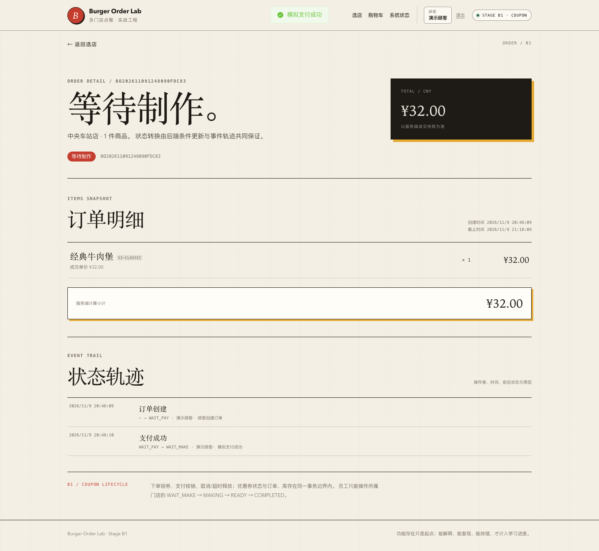
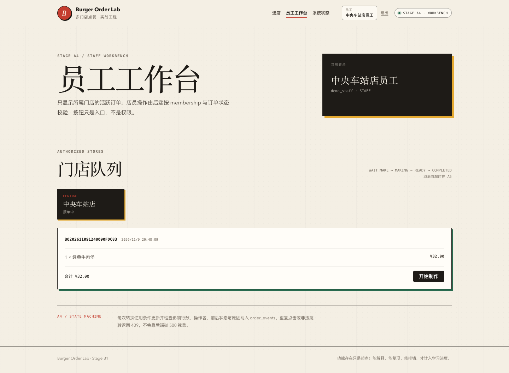
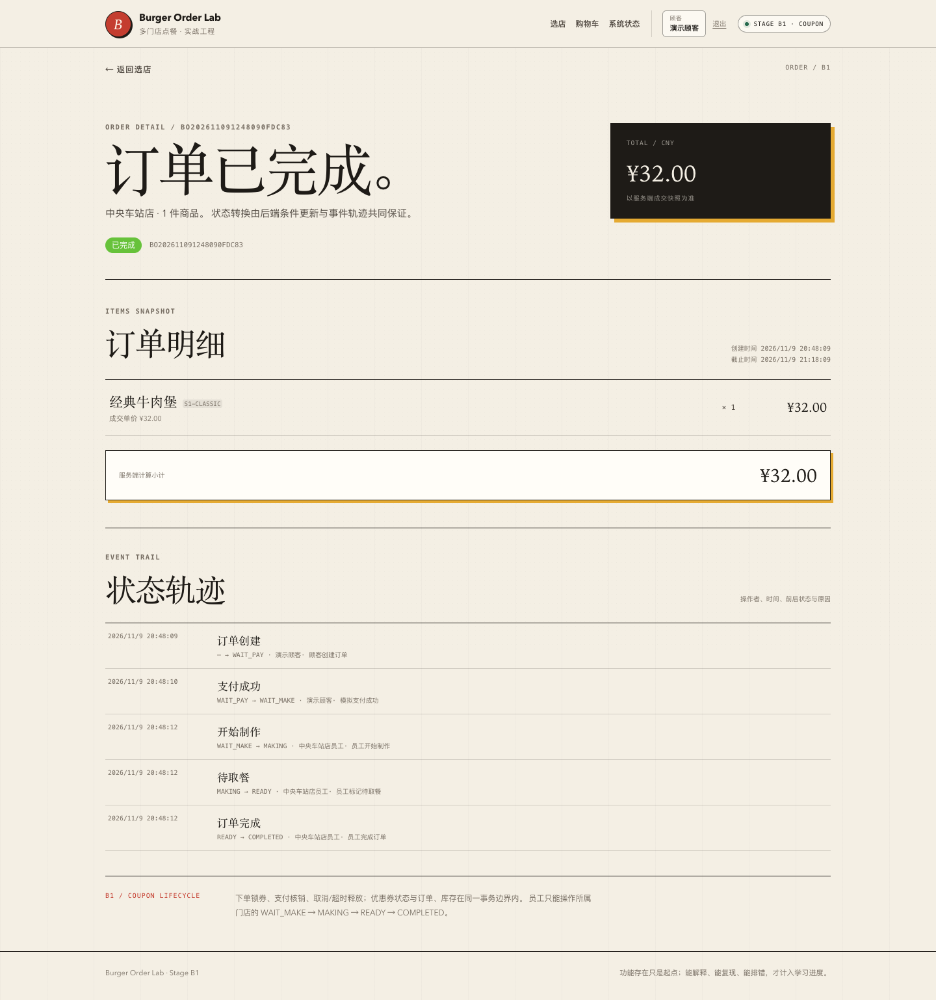

# 阶段 A4 实际验证记录

验证时间：2026-11-09 20:08–20:18（Asia/Shanghai）
范围：模拟支付、reserved 提交、员工工作台、状态转换、事件轨迹。
只对应本机实际结果，不代表生产容量。

## 1. 迁移

```text
Successfully validated 8 migrations
Migrating to version "8 - add payment transition support"
now at version v8
```

V8：

- stock_logs CHECK 增加 COMMIT；
- 新增 `idx_orders_store_status_created`。

没有新增 payments 表。

## 2. 后端测试

| 测试类 | 数量 | 内容 |
| --- | --- | --- |
| `OrderHttpIntegrationTest` | 11 | A3 下单/幂等/库存 + A4 支付/过期/重复支付/员工列表/状态转换/事件/越权 |
| `OrderConcurrencyIntegrationTest` | 3 | 同键并发、最后 1 件库存、并发支付 |
| `AuthSessionIntegrationTest` | 7 | A2 回归 |
| `StoreCatalogIntegrationTest` | 5 | A1 回归 |
| `PlatformHealthIntegrationTest` | 3 | 健康/Actuator |
| `PlatformHealthControllerTest` | 3 | 健康错误体 |
| `StoreControllerErrorTest` | 2 | 数据库故障映射 |
| 合计 | **34** | 0 failures, 0 errors, 0 skipped |

## 3. 实际完成订单 16

数据库：

```text
id=16 order_no=BO202611091248090FDC83 status=COMPLETED total=32.00
```

事件：

```text
CREATED            NULL      -> WAIT_PAY   演示顾客
PAYMENT_SUCCEEDED  WAIT_PAY  -> WAIT_MAKE  演示顾客
MAKING_STARTED     WAIT_MAKE -> MAKING     中央车站店员工
READY_FOR_PICKUP   MAKING    -> READY      中央车站店员工
COMPLETED          READY     -> COMPLETED  中央车站店员工
```

库存流水：

```text
RESERVE available_delta=-1 reserved_delta=+1 available_after=41 reserved_after=5
COMMIT  available_delta=0  reserved_delta=-1 available_after=41 reserved_after=4
```

支付只扣 reserved，不重复扣 available，符合 A4 规则。

## 4. 并发与错误语义

已实际测试：

- 同订单两线程同时支付：1 成功、1 `ORDER_STATUS_CONFLICT`，只 1 条 COMMIT 流水、1 条 PAYMENT_SUCCEEDED；
- 重复支付串行：409；
- 过期支付：409 `ORDER_EXPIRED`，订单仍 WAIT_PAY；
- 过期订单的 reserved 保留到 A5；
- 员工操作 WAIT_PAY 订单：409；
- 员工访问非所属门店：404；
- 顾客访问员工接口：403；
- 其他顾客支付订单：404；
- 员工状态机：WAIT_MAKE → MAKING → READY → COMPLETED，完成后从活跃列表消失。

## 5. 工作台 SQL 与执行计划

```sql
SELECT * FROM orders
WHERE store_id=1
  AND status IN ('WAIT_MAKE','MAKING','READY')
ORDER BY created_at, id;
```

实际：

```text
key=idx_orders_store_status_created
key_len=74
rows=3
Extra=Using index condition; Using filesort
```

索引用于过滤，但跨状态排序仍 filesort。当前只有 3 条活跃订单；不宣称排序已完全索引化，后续数据量增长需重新评估。

## 6. 前端测试与 E2E

```text
Vitest: 27 tests passed
  orderDetail 3
  checkout 3
  auth 4
  cart 5
  storeList 2
  storeMenu 3
  systemStatus 4
  formatPrice 3
```

Playwright：

```text
A2: 登录/角色/购物车路径通过
A3: 购物车 -> 订单 -> 刷新 -> 未登录重定向通过
A4: 订单 7 支付 -> 员工开始制作/待取餐/完成 -> 顾客查看 5 条事件通过
```

A4 实际输出：

```text
A4 browser smoke passed: BO202611091248090FDC83 paid -> staff workflow -> completed
```

## 7. 页面截图

> 截图说明：B1 最终回归时重跑了 A4 E2E，页脚显示 Stage B1；A4 功能边界不变。

### 支付成功后



### 员工工作台



### 完成后事件轨迹



## 8. OpenAPI

```bash
npx @redocly/cli@2.20.0 lint docs/api/openapi.yaml
```

结构有效，7 条风格 warning。未宣称零 warning。

## 9. 实际发现与修复

- `OrderHttpIntegrationTest` 过期支付用例最初把最终 stock 写成 `[48,0]`，实际过期订单仍保留 1 件 reserved，正确值为 `[48,1]`；修正测试期望。
- 支付并发测试最初按 50 初始库存断言，测试夹具实际是 10；修正为 `[9,0]`。
- 支付弹窗截图曾拍到遮罩淡出过程；E2E 增加等待 overlay hidden 后重拍。
- 生产路径没有编造新的故障或指标。

## 10. 已验证与未验证

### 已验证

- 支付只提交 reserved；
- 过期/重复支付；
- 支付并发只提交一次；
- 员工所属门店过滤；
- 员工状态机与事件；
- 顾客事件轨迹；
- 跨角色 401/403/404/409；
- 浏览器完整链路。

### 未验证

- 取消与超时释放（A5）；
- 支付/取消竞态（A5）；
- 员工重复点击并发双请求（条件更新存在，未单独压测）；
- payments 回调/退款/对账；
- 高并发、死锁重试、容量；
- 生产监控、审计、移动端。

## 11. 复现

```bash
./scripts/db-up.sh
JAVA_HOME="$(/usr/libexec/java_home -v 21)" ./scripts/run-backend.sh
cd frontend && pnpm dev

cd frontend && pnpm test:e2e:a4
```
