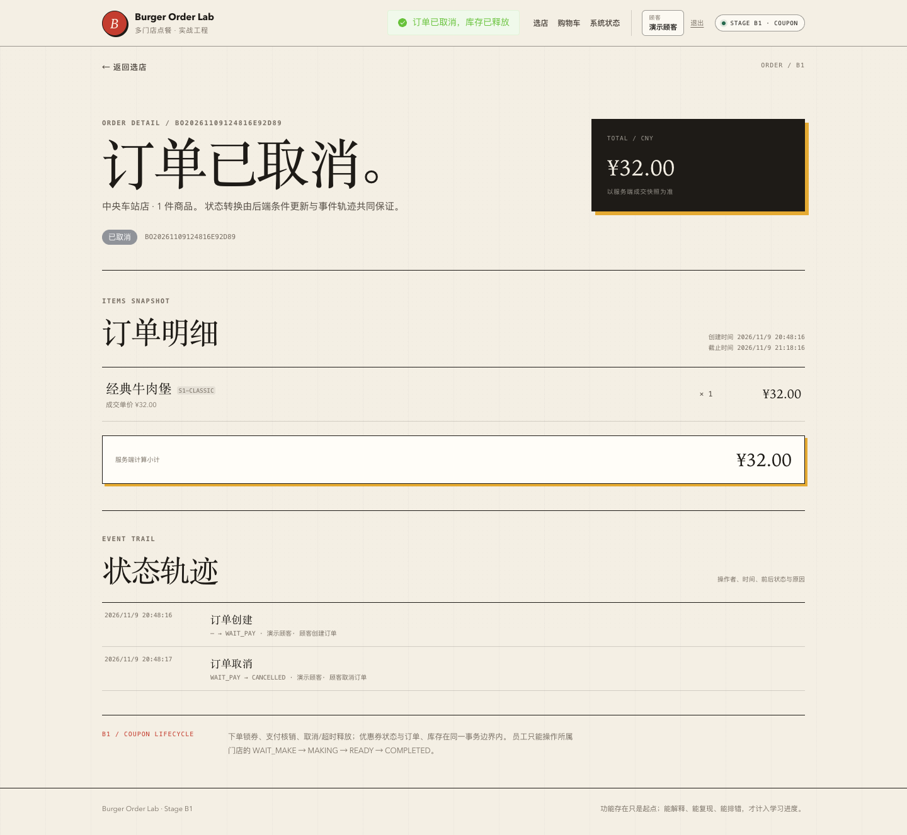

# 阶段 A5 实际验证记录

验证时间：2026-11-09 20:22–20:31（Asia/Shanghai）
范围：顾客取消、超时扫描、库存释放、支付/取消竞态、权限与关键集成验证。
只对应本机实际结果，不代表生产容量。

## 1. 迁移

```text
Successfully validated 9 migrations
Migrating to version "9 - add timeout scan index"
now at version v9
```

V9：

```sql
CREATE INDEX idx_orders_status_expires
    ON orders (status, expires_at, id);
```

没有新增表。

## 2. 后端测试

| 测试类 | 数量 | 内容 |
| --- | --- | --- |
| `OrderHttpIntegrationTest` | 13 | A3/A4/A5 下单、幂等、支付、员工、取消、权限 |
| `OrderConcurrencyIntegrationTest` | 4 | 同键并发、最后 1 件、支付并发、支付/取消竞态 |
| `OrderTimeoutIntegrationTest` | 2 | 超时释放、重复扫描、活跃订单不被误取消 |
| `AuthSessionIntegrationTest` | 7 | A2 回归 |
| `StoreCatalogIntegrationTest` | 5 | A1 回归 |
| `PlatformHealthIntegrationTest` | 3 | 健康/Actuator |
| `PlatformHealthControllerTest` | 3 | 健康错误体 |
| `StoreControllerErrorTest` | 2 | 数据库故障映射 |
| 合计 | **39** | 0 failures, 0 errors, 0 skipped |

## 3. 顾客取消实际结果

E2E 订单 17：

```text
BO20261109124816E92D89  CANCELLED  total=32.00
```

事件：

```text
CREATED    NULL      -> WAIT_PAY
CANCELLED  WAIT_PAY  -> CANCELLED   operator=1  顾客取消订单
```

库存：

```text
RESERVE  available_delta=-1  reserved_delta=+1  available_after=40 reserved_after=5
RELEASE  available_delta=+1  reserved_delta=-1  available_after=41 reserved_after=4
```

重复取消：409，不再 RELEASE；取消后支付：409。

## 4. 超时扫描实际结果

应用真实扫描把开发库中的过期 WAIT_PAY 订单 1、2、3 取消：

```text
CANCELLED  WAIT_PAY -> CANCELLED  operator_user_id=NULL  reason=支付超时自动取消
```

库存流水出现 RELEASE。扫描任务没有公开 HTTP 触发端点。

在采集时仍有一条 WAIT_PAY 订单 6 尚未超过 expires_at，扫描没有误取消它。

## 5. 超时索引执行计划

```sql
EXPLAIN SELECT id FROM orders
WHERE status='WAIT_PAY' AND expires_at <= UTC_TIMESTAMP(3)
ORDER BY expires_at, id
LIMIT 100;
```

实际：

```text
type=range
key=idx_orders_status_expires
key_len=73
rows=1
Extra=Using where; Using index
```

无 filesort。与 A4 工作台查询的 filesort 形成对照。

## 6. 支付/取消竞态

服务级并发测试同时发起：

```text
orderService.payOrder(orderId)
orderCancellationService.cancelByCustomer(orderId)
```

最终只允许：

```text
WAIT_MAKE + exactly one COMMIT
或
CANCELLED + exactly one RELEASE
```

测试断言：

- 1 成功、1 `ORDER_STATUS_CONFLICT`；
- 订单终态与库存终态一致；
- 不存在 COMMIT 与 RELEASE 同时出现；
- 只有一条对应终态事件。

## 7. 重复扫描与重复取消

- 超时批处理第一次取消 1 单，第二次取消 0 单；
- 只出现一条 RELEASE；
- 只出现一条 CANCELLED 事件；
- 活跃订单不被扫描误伤。

## 8. 权限

| 场景 | 实际 |
| --- | --- |
| 本人取消 WAIT_PAY | 200 |
| 其他顾客取消 | 404 |
| 员工取消 | 403 |
| 未登录取消 | 401 |
| 重复取消/取消后支付 | 409 |
| 员工工作台仍然只读所属门店 | 通过 A4 回归 |

## 9. 前端测试与 E2E

```text
Vitest: 29 tests passed
  orderDetail 5
  checkout 3
  auth 4
  cart 5
  storeList 2
  storeMenu 3
  systemStatus 4
  formatPrice 3
```

Playwright：

```text
A2/A3/A4 回归通过
A5: 顾客下单 -> 取消 -> 状态 CANCELLED/事件轨迹/刷新 -> 通过
```

A5 输出：

```text
A5 browser smoke passed: BO20261109124816E92D89 cancelled and stock release visible
```

## 10. 页面截图

> 截图说明：B1 回归时重跑了 A5 E2E，页脚/订单详情显示 B1；A5 功能边界不变。



## 11. OpenAPI

```bash
npx @redocly/cli@2.20.0 lint docs/api/openapi.yaml
```

结构有效，7 条风格 warning。未宣称零 warning。

## 12. 实际发现与修复

- A5 HTTP/超时/竞态测试在实现后通过。
- 超时扫描在开发库实际处理了过期的订单 1/2/3；没有编造扫描结果。
- 取消截图最初仍有 A4 文案，修正为 A5 后重拍。
- 没有编造生产事故或容量数据。

## 13. 已验证与未验证

### 已验证

- WAIT_PAY 顾客取消；
- reserved → available 释放；
- 重复取消不重复释放；
- 超时扫描与重复扫描；
- 支付/取消竞态唯一终态；
- 权限 401/403/404/409；
- 前端取消与事件轨迹；
- 超时索引无 filesort。

### 未验证

- 优惠券释放（尚无优惠券模块）；
- 退款；
- 已支付订单取消；
- 多实例扫描协调与指标；
- 高并发/死锁/容量；
- 超时扫描的管理端观测；
- 生产环境。

## 14. 复现

```bash
./scripts/db-up.sh
JAVA_HOME="$(/usr/libexec/java_home -v 21)" ./scripts/run-backend.sh
cd frontend && pnpm dev

cd frontend && pnpm test:e2e:a5
```
