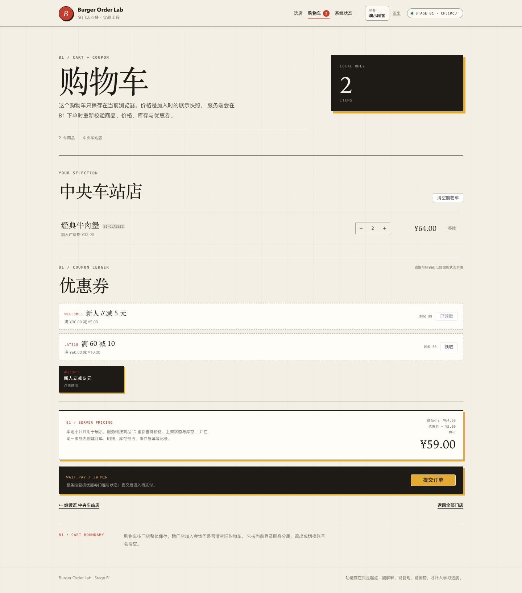
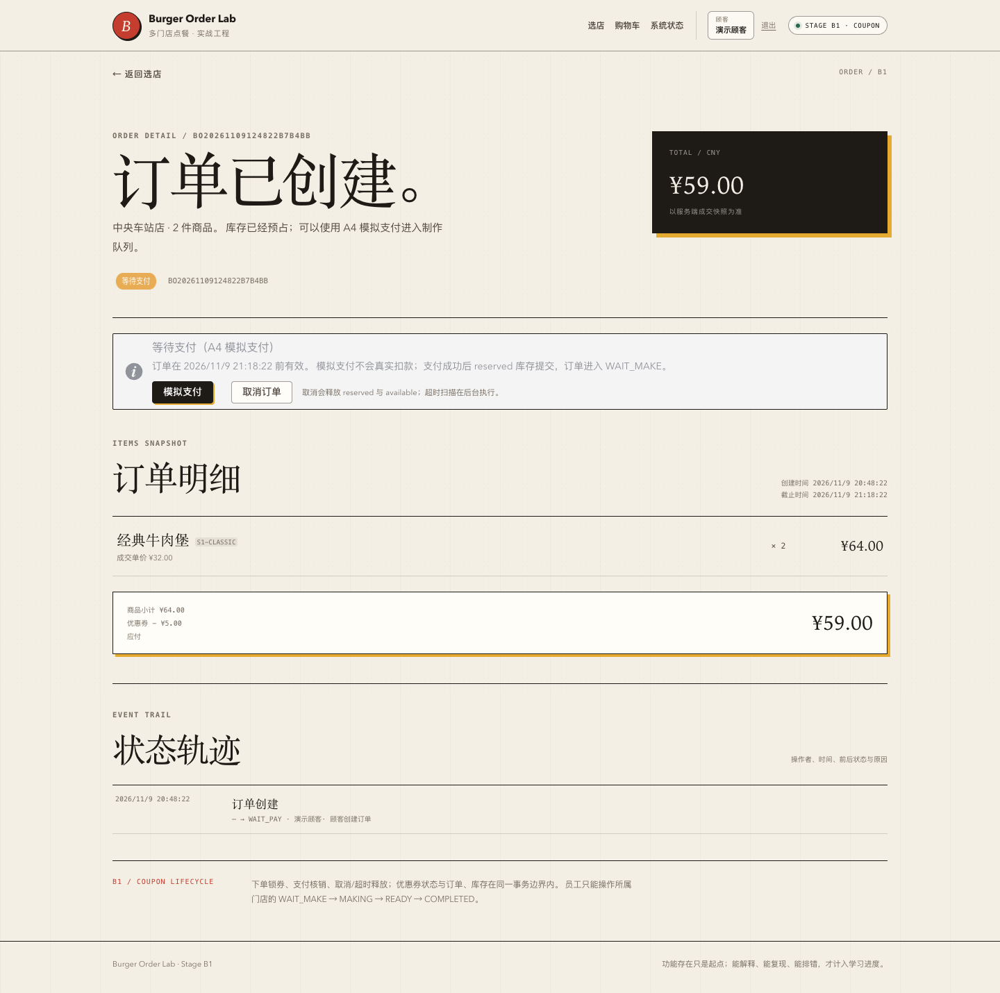

# 阶段 B1 实际验证记录

验证时间：2026-11-09 20:38–20:50（Asia/Shanghai）
范围：优惠券领取、总量/单用户并发、下单锁券、优惠金额、支付核销、取消释放。
只对应本机实际结果，不代表生产容量。

## 1. 迁移

```text
Successfully validated 10 migrations
Migrating to version "10 - create coupon tables"
now at version v10
```

新增 `coupon_templates`、`user_coupons`，以及 `orders.coupon_id`、`orders.discount_amount`。

## 2. 后端测试

| 测试类 | 数量 | 内容 |
| --- | --- | --- |
| `OrderHttpIntegrationTest` | 17 | A3–A5 回归 + 领券/重复领取/优惠下单/取消释放/支付核销/越权/门槛 |
| `CouponConcurrencyIntegrationTest` | 3 | 最后一张券、同用户并发领取、同一券并发下单 |
| `OrderConcurrencyIntegrationTest` | 4 | 同键、库存、支付、支付/取消竞态 |
| `OrderTimeoutIntegrationTest` | 2 | 超时释放、重复扫描 |
| `AuthSessionIntegrationTest` | 7 | 会话回归 |
| `StoreCatalogIntegrationTest` | 5 | 目录回归 |
| `PlatformHealthIntegrationTest` | 3 | 健康/Actuator |
| `PlatformHealthControllerTest` | 3 | 健康错误体 |
| `StoreControllerErrorTest` | 2 | 数据库故障映射 |
| 合计 | **46** | 0 failures, 0 errors, 0 skipped |

测试上下文已显式关闭超时调度器，避免测试容器关闭后后台任务重连导致日志噪声。生产默认仍开启。

## 3. 领取与并发

同一最后一张券，两个用户同时领取：

```text
1 个成功
1 个 COUPON_SOLD_OUT
claimed_quantity=1
user_coupons=1
```

同一用户两线程同时领取：

```text
1 个成功
1 个 COUPON_ALREADY_CLAIMED
claimed_quantity=1
user_coupons=1
```

同一张券两线程同时下单：

```text
orders=1
成功订单 discount_amount=5.00
user_coupons.status=LOCKED
另一单 COUPON_NOT_USABLE
```

## 4. B1 E2E 订单 18

```text
BO20261109124822B7B4BB  CANCELLED  total=59.00  discount=5.00  coupon_id=1
```

商品小计：

```text
经典牛肉堡 ×2 = 64.00
优惠券 WELCOME5 = -5.00
应付 = 59.00
```

库存流水：

```text
RESERVE available_delta=-2 reserved_delta=+2 available_after=39 reserved_after=6
RELEASE available_delta=+2 reserved_delta=-2 available_after=41 reserved_after=4
```

E2E 结束主动取消订单，优惠券释放：

```text
user_coupons id=1 status=UNUSED order_id=NULL version=6
```

模板：

```text
WELCOME5 claimed_quantity=1 total_quantity=100
LATE10   claimed_quantity=0 total_quantity=50
```

## 5. 领取条件更新执行计划

```sql
EXPLAIN UPDATE coupon_templates
SET claimed_quantity = claimed_quantity + 1, version = version + 1
WHERE id = 1 AND status = 'ACTIVE' AND claimed_quantity < total_quantity;
```

实际：

```text
key=PRIMARY
rows=1
Extra=Using where
```

总量闸门使用主键条件更新；单用户闸门使用 `uk_user_coupons_template_user`。

## 6. 前端测试与 E2E

```text
Vitest: 30 tests passed
  checkout 4
  orderDetail 5
  auth 4
  cart 5
  storeList 2
  storeMenu 3
  systemStatus 4
  formatPrice 3
```

Playwright：

```text
A2/A3/A4/A5 回归通过
B1: 登录 -> 加购 -> 领券 -> 选券 -> 应付 59 -> 下单 -> 订单详情优惠 -> 取消释放
```

实际输出：

```text
B1 browser smoke passed: claim coupon -> select -> order with 5.00 discount -> release
```

## 7. 页面截图

### 购物车领券/选券



### 订单详情优惠



## 8. OpenAPI

```bash
npx @redocly/cli@2.20.0 lint docs/api/openapi.yaml
```

结构有效，7 条风格 warning。

## 9. 实际发现与修复

- B1 E2E 第一次重跑时优惠券已被上一笔订单 LOCKED，脚本不可重复；改为结束时取消订单释放券，并在选择前判断 active 状态。
- 购物车 full-page 截图把 sticky header 截在页面中部；先滚动到顶部再截图。
- 全量测试中，测试上下文关闭后调度器仍尝试连接已销毁的容器，产生错误日志；集成测试统一设置 `app.order.timeout-scan.enabled=false`。
- 没有编造生产故障或容量指标。

## 10. 已验证与未验证

### 已验证

- 最后一张券并发只成功一次；
- 同用户并发只领一张；
- 同一券并发只锁一单；
- 优惠金额/应付/门槛；
- 支付核销、取消释放；
- 前端领券/选券/优惠下单；
- 订单/库存/券事务失败回滚路径由 HTTP 测试覆盖。

### 未验证

- 百分比券与舍入；
- 多券叠加/互斥；
- 券过期扫描；
- 管理端发券/作废；
- 领取限流/防刷；
- 高并发/压测；
- 生产环境。

## 11. 复现

```bash
./scripts/db-up.sh
JAVA_HOME="$(/usr/libexec/java_home -v 21)" ./scripts/run-backend.sh
cd frontend && pnpm dev

cd frontend && pnpm test:e2e:b1
```
