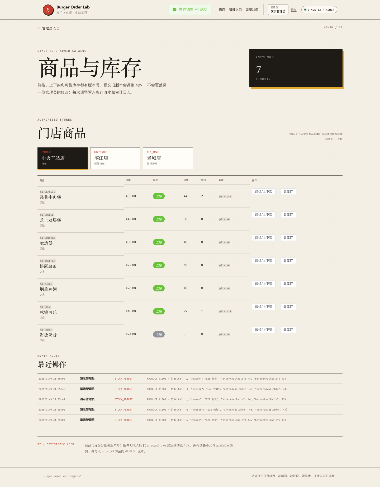

# 阶段 B2 实际验证记录

验证时间：2026-11-09 20:55–21:08（Asia/Shanghai）
范围：管理员商品列表、改价/上下架、库存调整、乐观锁、审计、权限。
只对应本机实际结果，不代表生产容量。

## 1. 迁移

```text
Successfully validated 11 migrations
Migrating to version "11 - add admin inventory management"
now at version v11
```

V11：

- products.version；
- stock_logs.order_id 可空 + operator_user_id；
- admin_audit_logs。

## 2. 后端测试

| 测试类 | 数量 | 内容 |
| --- | --- | --- |
| `AdminInventoryIntegrationTest` | 4 | 改价/上下架、库存调整、旧版本/负库存/权限、并发调整 |
| `OrderHttpIntegrationTest` | 17 | A3–B1 回归 |
| `CouponConcurrencyIntegrationTest` | 3 | 优惠券并发 |
| `OrderConcurrencyIntegrationTest` | 4 | 订单并发 |
| `OrderTimeoutIntegrationTest` | 2 | 超时 |
| `AuthSessionIntegrationTest` | 7 | 会话 |
| `StoreCatalogIntegrationTest` | 5 | 目录 |
| `PlatformHealthIntegrationTest` | 3 | 健康 |
| `PlatformHealthControllerTest` | 3 | 健康错误 |
| `StoreControllerErrorTest` | 2 | 数据库故障 |
| 合计 | **50** | 0 failures, 0 errors, 0 skipped |

测试上下文已禁用调度器，日志无定时任务重连错误。

## 3. 商品改价/上下架

HTTP 测试：

```text
price 32.00 -> 33.50
onSale true -> false
product version 0 -> 1
公开菜单不再包含 S1-CLASSIC
恢复 price=32.00/onSale=true，version=2
审计 2 条
```

旧版本更新返回 409 `VERSION_CONFLICT`。

## 4. 库存调整

B2 E2E 实际：

```text
available 40 -> 41 (+1 补货) -> 40 (-1 恢复)
reserved 保持 4
stock version 前进
```

库存流水：

```text
order_id=NULL operator_user_id=3 change_type=ADJUST
+1 / 0  after available=41 reserved=4 reason=E2E 补货
-1 / 0  after available=40 reserved=4 reason=E2E 恢复
```

审计：

```json
{"delta": 1, "reason": "E2E 补货", "afterAvailable": 41, "beforeAvailable": 40}
```

并发：

```text
两个管理员同一 stock version 同时 +1
1 成功
1 VERSION_CONFLICT
最终 available=51
只有 1 条 ADJUST 流水
只有 1 条审计
```

## 5. 实际数据

```text
product 1001: price=32.00 on_sale=1 version=0
stock 1001:   available=40 reserved=4 version=52
```

管理员商品查询：

```text
products: ref uk_products_store_code, rows=7, Using filesort
stock:    eq_ref PRIMARY, rows=1
```

当前每店 7 个商品，filesort 可接受；B3 再评估专用索引。

## 6. 权限

- CUSTOMER 调管理接口：403；
- STAFF 调管理接口：403；
- ADMIN：允许；
- 未登录：401；
- CSRF 缺失：403。

## 7. 前端测试与 E2E

```text
Vitest: 30 tests passed
Playwright: A2/A3/A4/A5/B1 回归 + B2 管理台
B2: 管理员入口 -> 商品库存 -> +1 -> 审计 -> -1 恢复
```

实际输出：

```text
B2 browser smoke passed: admin stock 40 -> 41 -> 40 with audit
```

## 8. 页面截图



## 9. OpenAPI

```bash
npx @redocly/cli@2.20.0 lint docs/api/openapi.yaml
```

结构有效，7 条风格 warning。

## 10. 实际发现与修复

- B2 首次 E2E 点击“调库存”没有对话框；DOM 出现原始 `<el-dialog>`。根因是 Element Plus 按需注册漏了 `ElDialog`、`ElSwitch` 及样式。补齐后通过。
- 管理表格首列 `display:grid` 让 `code` 背景被拉伸成灰条；`justify-items:start` 修复。
- 审计 code 同样被 grid 拉伸；改为透明内联。
- 未编造生产故障或容量指标。

## 11. 已验证与未验证

### 已验证

- ADMIN 商品列表；
- 改价/上下架 + 公开菜单联动；
- 商品版本冲突；
- 库存调整 + 非负约束；
- 库存版本冲突；
- 并发调整唯一赢家；
- ADJUST 流水与审计；
- 角色/CSRF；
- 管理台 E2E。

### 未验证

- 新建/删除商品；
- 门店营业/接单开关；
- 批量导入/导出；
- 管理列表分页/索引；
- 审批流/回滚；
- 高并发/容量；
- 生产环境。

## 12. 复现

```bash
./scripts/db-up.sh
JAVA_HOME="$(/usr/libexec/java_home -v 21)" ./scripts/run-backend.sh
cd frontend && pnpm dev

cd frontend && pnpm test:e2e:b2
```
