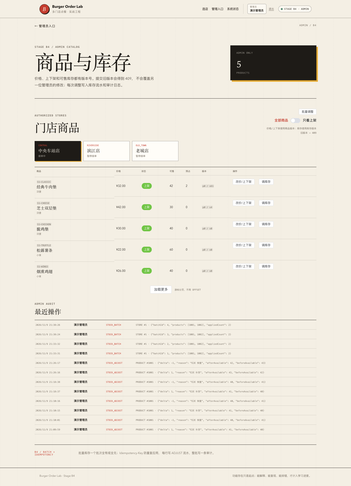

# 阶段 B3 实际验证记录

验证时间：2026-11-09 21:12–21:24（Asia/Shanghai）
范围：管理端商品 keyset 分页、上架筛选、索引/EXPLAIN、前端加载更多。
只对应本机实际结果，不代表生产容量。

## 1. 迁移

```text
Successfully validated 12 migrations
Migrating to version "12 - add admin product pagination indexes"
now at version v12
```

V12：

```sql
CREATE INDEX idx_products_store_id ON products (store_id, id);
CREATE INDEX idx_products_store_onsale_id ON products (store_id, on_sale, id);
```

## 2. 后端测试

| 测试类 | 数量 | 内容 |
| --- | --- | --- |
| `AdminInventoryIntegrationTest` | 6 | B2 管理写 + B3 商品分页/筛选/深游标 |
| `OrderHttpIntegrationTest` | 17 | A3–B1 回归 |
| `CouponConcurrencyIntegrationTest` | 3 | 优惠券并发 |
| `OrderConcurrencyIntegrationTest` | 4 | 订单并发 |
| `OrderTimeoutIntegrationTest` | 2 | 超时 |
| `AuthSessionIntegrationTest` | 7 | 会话 |
| `StoreCatalogIntegrationTest` | 5 | 目录 |
| `PlatformHealthIntegrationTest` | 3 | 健康 |
| `PlatformHealthControllerTest` | 3 | 健康错误 |
| `StoreControllerErrorTest` | 2 | 数据库故障 |
| 合计 | **52** | 0 failures, 0 errors, 0 skipped |

## 3. 分页语义

开发库 7 个商品：

```text
首屏 limit=5 -> 5 条，hasMore=true，nextCursor=第 5 条 id
加载更多 -> 追加 2 条，共 7 条，hasMore=false
只看上架 -> 首屏 5 条，hasMore=true
加载更多 -> 共 6 条（S1-SHAKE 下架被排除）
```

测试还插入 60 条 `PAGE-%` 临时商品，验证：

```text
afterId = PAGE-050 的 id
limit=5
返回 5 条，全部 id > afterId
hasMore=true
```

不依赖 OFFSET。

## 4. 受控 EXPLAIN

在事务内插入 100 条临时商品并 EXPLAIN，最后 ROLLBACK。

普通分页，不强制索引：

```text
key=uk_products_store_code
rows=107
Extra=Using index condition; Using filesort
```

强制：

```text
type=range
key=idx_products_store_id
rows=107
Extra=Using index condition
```

上架筛选强制：

```text
type=range
key=idx_products_store_onsale_id
key_len=17
Extra=Using index condition
```

结论：仅“加索引”不足以保证计划；B3 Mapper 显式 FORCE INDEX，换取 keyset 排序无 filesort。该选择有索引维护成本，已写入文档。

## 5. 前端测试与 E2E

```text
Vitest: 30 tests passed
Playwright: A2/A3/A4/A5/B1 回归 + B2 + B3
B3: 管理台首屏 5 -> 加载更多 7 -> 只看上架 6
B2 回归：库存 +1 -> 审计 -> -1
```

实际输出：

```text
B3 browser smoke passed: keyset page 5 -> 7, on-sale filter -> 6
B2 browser smoke passed: admin stock 40 -> 41 -> 40 with audit
```

## 6. 页面截图

> B4 回归说明：最终 B4 回归时重跑了 B3 E2E，截图页脚/阶段标签显示 B4；B3 的分页功能与数据不变。



B2 历史截图已保留，未被 B3 覆盖。

## 7. OpenAPI

```bash
npx @redocly/cli@2.20.0 lint docs/api/openapi.yaml
```

结构有效，7 条风格 warning。

## 8. 实际发现与修复

- 小数据下优化器不选新索引，仍唯一键 + filesort；先用受控 100 行实验确认，再显式 FORCE INDEX，未把“加索引”误报为“索引生效”。
- B3 首张截图中状态标签是细绿条：`el-tag` 挂载动画 `scaleX≈0`，截图时未稳定；E2E 等待标签宽度 >20 后重拍。
- B2 截图被 B3 回归覆盖，已从备份恢复，阶段证据不互相覆盖。
- 未编造生产故障或容量指标。

## 9. 已验证与未验证

### 已验证

- keyset 首屏/下一页；
- nextCursor/hasMore；
- 上架筛选；
- 60 条临时数据深游标；
- 受控 100 行 EXPLAIN；
- 前端加载更多；
- B2 管理写回归。

### 未验证

- 百万/千万行压测；
- 关键词搜索；
- 随机跳页/总数；
- 翻页期间并发删除/插入的完整语义；
- 多字段排序游标；
- 多实例/缓存；
- 生产环境。

## 10. 复现

```bash
./scripts/db-up.sh
JAVA_HOME="$(/usr/libexec/java_home -v 21)" ./scripts/run-backend.sh
cd frontend && pnpm dev

cd frontend && pnpm test:e2e:b3
```
