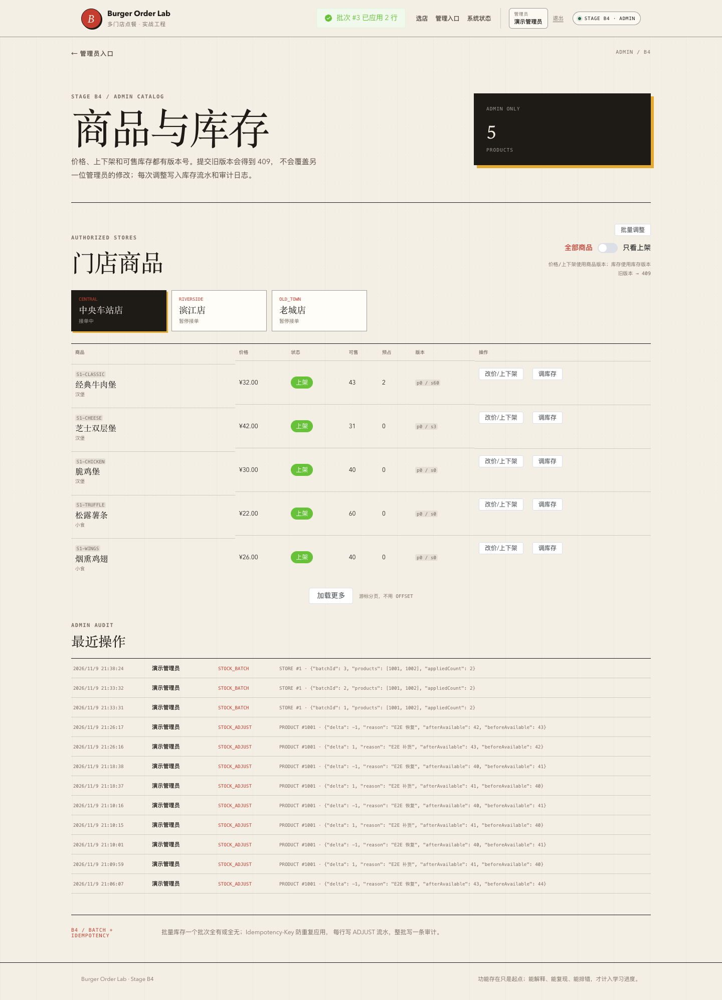

# 阶段 B4 实际验证记录

验证时间：2026-11-09 21:30–21:38（Asia/Shanghai）
范围：管理员批量库存、幂等键、全有或全无、并发重放、流水/审计。
只对应本机实际结果，不代表生产容量。

## 1. 迁移

```text
Successfully validated 13 migrations
Migrating to version "13 - create admin stock batches"
now at version v13
```

新增 `admin_stock_batches`、`admin_stock_batch_lines`。

## 2. 后端测试

| 测试类 | 数量 | 内容 |
| --- | --- | --- |
| `AdminInventoryIntegrationTest` | 10 | B2/B3 + 批次成功/重放/冲突/回滚/权限/同键并发 |
| `OrderHttpIntegrationTest` | 17 | A3–B1 回归 |
| `CouponConcurrencyIntegrationTest` | 3 | 优惠券并发 |
| `OrderConcurrencyIntegrationTest` | 4 | 订单并发 |
| `OrderTimeoutIntegrationTest` | 2 | 超时 |
| `AuthSessionIntegrationTest` | 7 | 会话 |
| `StoreCatalogIntegrationTest` | 5 | 目录 |
| `PlatformHealthIntegrationTest` | 3 | 健康 |
| `PlatformHealthControllerTest` | 3 | 健康错误 |
| `StoreControllerErrorTest` | 2 | 数据库故障 |
| 合计 | **56** | 0 failures, 0 errors, 0 skipped |

## 3. 批次成功与重放

```text
POST /api/admin/stores/1/stock-adjustments/batch
Idempotency-Key: batch-key-0001
lines: 1001 +2, 1006 -1

首次 201 appliedCount=2
1001 50 -> 52
1006 100 -> 99
batch=1 lines=2 audit=1

同 key 同 body -> 200 Idempotent-Replayed=true
same batchId, stock 不变, batch 仍 1 条

同 key 不同 body -> 409 IDEMPOTENCY_CONFLICT
```

## 4. 失败整批回滚

```text
1001 +1（合法）
1006 -1000（非法）

HTTP 409 STOCK_INSUFFICIENT
batch=0 lines=0 stock_logs=0 audit=0
1001=50,1006=100
```

## 5. 同键并发

两个线程同 key 同 body：

```text
一个 replayed=false，一个 replayed=true
同一个 batchId
1001=51（只 +1）
batch=1 lines=1 ADJUST=1 audit=1
```

### 测试先失败后修复

最初第二个线程在唯一键冲突后普通 `SELECT`，REPEATABLE READ 快照看不到已提交 batch，误报 `BATCH_IN_PROGRESS`。

修复：

```sql
SELECT ... WHERE admin_user_id=? AND idempotency_key=? FOR UPDATE
```

当前读后正确重放。该失败是 B4 实际发现，不是事后编造。

## 6. B4 E2E

```text
首轮 E2E:
batch 1: 1001 +1, 1002 +1, reason E2E批次补货
batch 2: 1001 -1, 1002 -1, reason E2E批次恢复

后续回归会产生新的 batchId；数据/审计语义不变。
```

实际输出：

```text
B4 browser smoke passed: batch +1 -> 43 -> 42, audit
```

库存：

```text
batch 1: 1001 42->43, 1002 30->31
batch 2: 1001 43->42, 1002 31->30
```

审计：

```json
{"batchId":1,"appliedCount":2,"products":[1001,1002]}
```

## 7. 页面截图



## 8. OpenAPI

```bash
npx @redocly/cli@2.20.0 lint docs/api/openapi.yaml
```

结构有效，7 条风格 warning。

## 9. 实际发现与修复

- REPEATABLE READ 普通读看不到并发提交批次；`FOR UPDATE` 修复。
- 批次全有或全无验证：失败批次没有 batch/line/log/audit。
- 同幂等键并发只应用一次库存。
- 没有编造生产故障或容量指标。

## 10. 已验证与未验证

### 已验证

- 批次 1–2 行成功；
- 同键同体重放；
- 同键异体冲突；
- 单行失败整批回滚；
- 权限/缺 key；
- 同键并发只应用一次；
- 流水/审计；
- 前端批量输入。

### 未验证

- 部分成功/逐行结果；
- CSV 上传/dry-run；
- 100 行上限边界；
- 大批次性能；
- 异步任务/进度；
- 批次历史/撤销；
- 生产环境。

## 11. 复现

```bash
./scripts/db-up.sh
JAVA_HOME="$(/usr/libexec/java_home -v 21)" ./scripts/run-backend.sh
cd frontend && pnpm dev

cd frontend && pnpm test:e2e:b4
```
