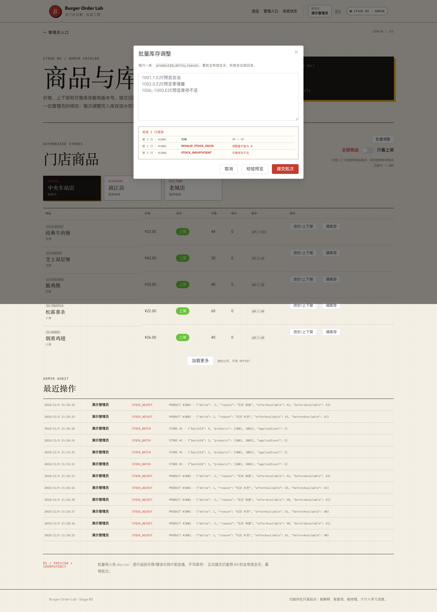

# 阶段 B5 实际验证记录

验证时间：2026-11-09 21:40–21:47（Asia/Shanghai）
范围：批量库存 dry-run、逐行校验、只读预览、管理台预览。
只对应本机实际结果，不代表生产容量。

## 1. 迁移

B5 没有新增迁移，数据库仍为 V13。

## 2. 后端测试

| 测试类 | 数量 | 内容 |
| --- | --- | --- |
| `AdminInventoryIntegrationTest` | 13 | B2–B4 + B5 预览有效/错误/权限 |
| `OrderHttpIntegrationTest` | 17 | A3–B1 回归 |
| `CouponConcurrencyIntegrationTest` | 3 | 优惠券并发 |
| `OrderConcurrencyIntegrationTest` | 4 | 订单并发 |
| `OrderTimeoutIntegrationTest` | 2 | 超时 |
| `AuthSessionIntegrationTest` | 7 | 会话 |
| `StoreCatalogIntegrationTest` | 5 | 目录 |
| `PlatformHealthIntegrationTest` | 3 | 健康 |
| `PlatformHealthControllerTest` | 3 | 健康错误 |
| `StoreControllerErrorTest` | 2 | 数据库故障 |
| 合计 | **59** | 0 failures, 0 errors, 0 skipped |

## 3. 有效预览不写库

```text
1001 +2, 1006 -1
HTTP 200 valid=true errorCount=0
1001 before=50 after=52
1006 before=100 after=99
```

实际库存/计数：

```text
stock 1001=50, 1006=100
admin_stock_batches=0
stock_logs=0
admin_audit_logs=0
```

## 4. 逐行错误预览

```text
1001 +1 合法
1002 0 零调整
1002 +1 重复商品
1006 -1000 库存不足
```

结果：

```text
valid=false errorCount=3
line1 valid
line2 INVALID_STOCK_DELTA
line3 DUPLICATE_BATCH_PRODUCT
line4 STOCK_INSUFFICIENT
```

库存、批次、流水、审计均不变。

## 5. 权限

CUSTOMER 调用预览：403。

## 6. B5 E2E

管理台批量对话框：

```text
1001,1,E2E预览合法
1002,0,E2E预览零增量
1006,-1000,E2E预览库存不足
```

实际输出：

```text
B5 browser smoke passed: preview 3 lines, 2 errors, stock unchanged
```

## 7. 页面截图



## 8. OpenAPI

```bash
npx @redocly/cli@2.20.0 lint docs/api/openapi.yaml
```

结构有效，7 条风格 warning。

## 9. 实际发现与修复

- 第一次 E2E 预览没有出现：前端预解析直接拒绝 `delta=0`，请求没有发出。预览应允许零/非法行交给后端逐行报告；修复后通过。
- 错误码 `INVALID_STOCK_DELTA` 在窄列中断行；加宽错误码列后重拍。
- 未编造生产故障或容量数据。

## 10. 已验证与未验证

### 已验证

- 有效预览不写库；
- 逐行错误；
- 零/重复/库存不足；
- 权限；
- 前端预览；
- 预览后正式执行仍走 B4。

### 未验证

- CSV 文件上传；
- dry-run 与执行 diff；
- 部分成功；
- 1MB/100 行边界；
- 预览与执行间的库存锁定；
- 生产环境。

## 11. 复现

```bash
./scripts/db-up.sh
JAVA_HOME="$(/usr/libexec/java_home -v 21)" ./scripts/run-backend.sh
cd frontend && pnpm dev

cd frontend && pnpm test:e2e:b5
```
