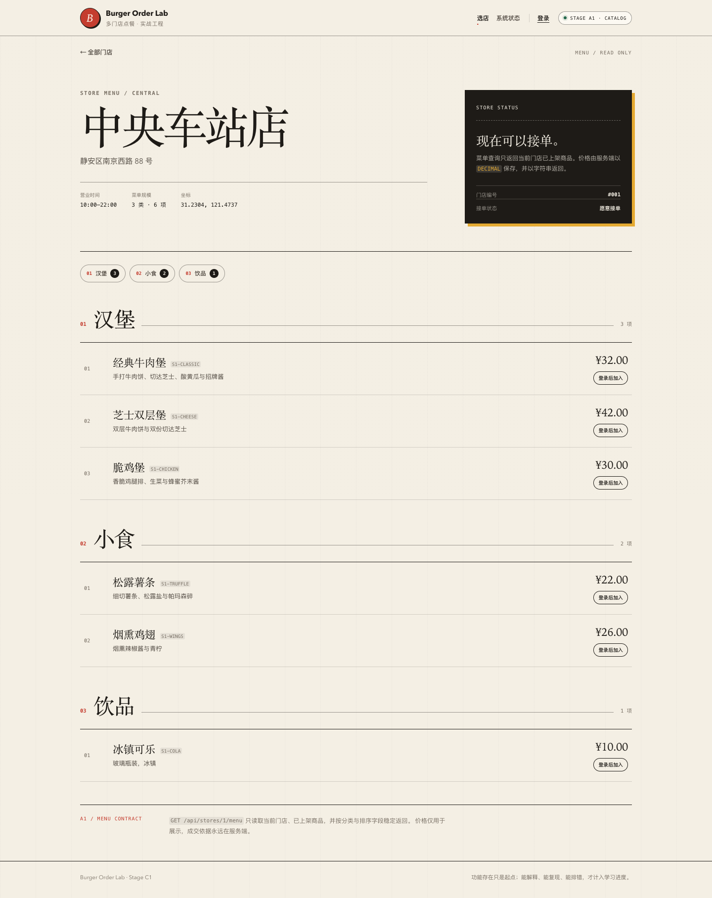

# 阶段 C1 实际验证记录

验证时间：2026-11-09 21:52–22:00（Asia/Shanghai）
范围：Redis 菜单缓存、TTL、管理端失效、降级、测试隔离、X-Cache。
只对应本机实际结果，不代表生产容量。

## 1. 迁移/基础设施

- 无新增 Flyway 迁移，数据库仍为 V13。
- 新增 Redis 7.4-alpine 容器，`127.0.0.1:16379`，healthy。
- `spring-boot-starter-data-redis`。

## 2. 后端测试

| 测试类 | 数量 | 内容 |
| --- | --- | --- |
| `MenuCacheIntegrationTest` | 2 | MISS/HIT/TTL、管理端改价/下架失效 |
| `MenuCacheServiceTest` | 1 | Redis 故障 BYPASS 回源 |
| `AdminInventoryIntegrationTest` | 13 | B2–B5 回归 |
| `OrderHttpIntegrationTest` | 17 | A3–B1 回归 |
| `CouponConcurrencyIntegrationTest` | 3 | 优惠券 |
| `OrderConcurrencyIntegrationTest` | 4 | 订单 |
| `OrderTimeoutIntegrationTest` | 2 | 超时 |
| `AuthSessionIntegrationTest` | 7 | 会话 |
| `StoreCatalogIntegrationTest` | 5 | 目录 |
| `PlatformHealthIntegrationTest` | 3 | 健康 |
| `PlatformHealthControllerTest` | 3 | 健康错误 |
| `StoreControllerErrorTest` | 2 | 数据库故障 |
| 合计 | **62** | 0 failures, 0 errors, 0 skipped |

非缓存测试统一 `app.cache.menu.enabled=false`，避免写开发 Redis。

## 3. 缓存行为

```text
首次 GET /api/stores/1/menu -> X-Cache: MISS
第二次 GET -> X-Cache: HIT
两次 body 相同
Redis key menu:v1:1 TTL 0 < ttl <= 60
```

C1 E2E 前 FLUSHDB：

```text
C1 browser smoke passed: menu X-Cache MISS -> HIT
```

## 4. 管理端失效

集成测试：

```text
1. 菜单 MISS 写入缓存
2. 管理员 PATCH 1001 price=33.50 onSale=false
3. 事务提交后删除 menu:v1:1
4. 再 GET 菜单 -> MISS
5. 菜单不再包含 S1-CLASSIC
```

## 5. 故障降级

单元测试：

```text
Redis GET 抛 RedisConnectionFailureException
-> MenuCacheService 返回 BYPASS
-> CatalogService 被调用
-> 菜单仍返回
```

## 6. 页面截图

菜单页面本身无感；缓存通过响应头观察。



## 7. OpenAPI

```bash
npx @redocly/cli@2.20.0 lint docs/api/openapi.yaml
```

结构有效，7 条风格 warning。

## 8. 实际发现与修复

- 非缓存集成测试默认会连接开发 Redis，可能把测试 MySQL 的菜单写进开发缓存；增加 `app.cache.menu.enabled=false` 测试隔离，C1 测试使用独立 Redis Testcontainer。
- 缓存测试容器关闭后 Lettuce 可能打印重连日志，不影响测试结果。
- 没有编造生产故障或命中率数据。

## 9. 已验证与未验证

### 已验证

- MISS/HIT；
- TTL；
- 管理端改价/下架后失效；
- Redis 故障 BYPASS；
- 测试隔离；
- X-Cache。

### 未验证

- 缓存穿透（空值/布隆）；
- 击穿（single-flight/分布式锁）；
- 雪崩（TTL 抖动）；
- 多实例广播失效；
- 命中率指标；
- 门店营业状态变更失效；
- 生产 Redis/集群/容量。

## 10. 复现

```bash
./scripts/db-up.sh
JAVA_HOME="$(/usr/libexec/java_home -v 21)" ./scripts/run-backend.sh
cd frontend && pnpm dev

docker compose ... exec -T redis redis-cli FLUSHDB
cd frontend && pnpm test:e2e:c1
```
