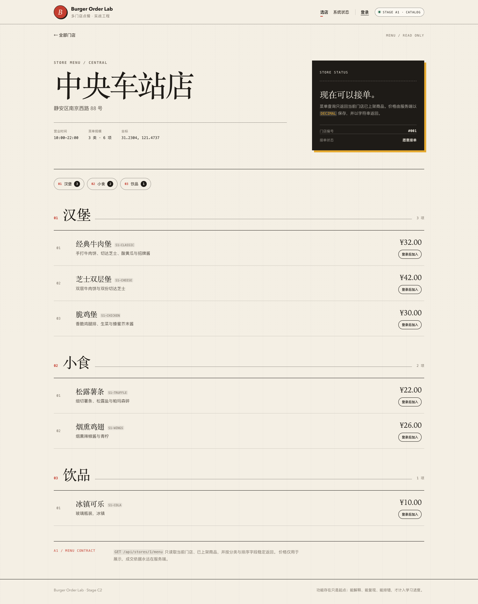

# 阶段 C2 实际验证记录

验证时间：2026-11-09 22:19–22:25（Asia/Shanghai）
范围：本地 single-flight、负缓存、TTL 抖动、缓存统计、降级。
只对应本机实际结果，不代表生产容量。

## 1. 迁移/基础设施

- 无新增 Flyway 迁移，仍为 V13。
- Redis 7.4-alpine，16379，healthy。

## 2. 后端测试

| 测试类 | 数量 | 内容 |
| --- | --- | --- |
| `MenuCacheIntegrationTest` | 4 | MISS/HIT/TTL、管理端失效、负缓存、统计端点 |
| `MenuCacheServiceTest` | 2 | single-flight 一次回源、Redis 故障 BYPASS |
| `AdminInventoryIntegrationTest` | 13 | B2–B5 回归 |
| `OrderHttpIntegrationTest` | 17 | A3–B1 回归 |
| `CouponConcurrencyIntegrationTest` | 3 | 优惠券 |
| `OrderConcurrencyIntegrationTest` | 4 | 订单 |
| `OrderTimeoutIntegrationTest` | 2 | 超时 |
| `AuthSessionIntegrationTest` | 7 | 会话 |
| `StoreCatalogIntegrationTest` | 5 | 目录 |
| `PlatformHealthIntegrationTest` | 3 | 健康 |
| `PlatformHealthControllerTest` | 3 | 健康错误 |
| `StoreControllerErrorTest` | 2 | 数据库故障 |
| 合计 | **65** | 0 failures, 0 errors, 0 skipped |

## 3. single-flight

单元测试 4 个线程并发 MISS：

```text
CatalogService.getMenu 调用 1 次
4 个结果复用同一 MenuResponse
stampedeWait > 0
```

等待上限 500ms；超时 BYPASS。

## 4. 负缓存

```text
GET /api/stores/999/menu -> 404
GET 第二次 -> 404
Redis menu:v1:999 = __MISSING__
TTL 0 < TTL <= 10
```

第二次不再回源数据库。

## 5. TTL 抖动

正常菜单：

```text
TTL 0 < TTL <= 75
```

基础 60 + 随机 0–15 秒。

## 6. 统计

C2 E2E：

```text
5 个并发菜单请求
后续一次 HIT
GET /api/system/menu-cache

{"hit":1,"miss":1,"bypass":0,"negative":2,"stampedeWait":4}
```

后续回归在同一进程内累计为 `{hit:3,miss:2,bypass:0,negative:4,stampedeWait:8}`；计数不自动清零，证明是进程内累计值。

说明：

- 1 个 leader 回源；
- 4 个 follower 等待；
- 1 次缓存命中；
- 2 次负缓存命中。

## 7. 页面截图



菜单页面本身无变化；缓存/统计通过响应头和统计端点观察。

## 8. OpenAPI

```bash
npx @redocly/cli@2.20.0 lint docs/api/openapi.yaml
```

结构有效，8 条风格 warning。

## 9. 实际发现与修复

- 单实例 single-flight 需要 double-check cache，避免抢到 leader 前别人已写入。
- followers 必须有 500ms 上限；否则 leader 卡住会拖死请求。
- 负缓存 TTL 10s，避免门店创建后长期 404。
- 非缓存测试仍关闭缓存，避免污染开发 Redis。
- 没有编造生产 QPS、命中率或容量数据。

## 10. 已验证与未验证

### 已验证

- 同实例并发 MISS 只回源一次；
- 负缓存；
- TTL 抖动上限；
- 统计端点；
- 管理端失效；
- Redis 故障 BYPASS。

### 未验证

- 多实例/分布式 single-flight；
- 多实例失效广播；
- 指标持久化/聚合；
- 布隆过滤器；
- 生产 QPS/容量；
- 负缓存门店创建主动清理。

## 11. 复现

```bash
./scripts/db-up.sh
JAVA_HOME="$(/usr/libexec/java_home -v 21)" ./scripts/run-backend.sh
cd frontend && pnpm dev

docker compose ... exec -T redis redis-cli FLUSHDB
cd frontend && pnpm test:e2e:c2
```
