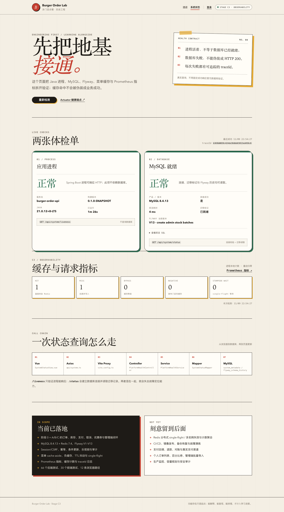

# 阶段 C3 实际验证记录

验证时间：2026-11-09 22:30–22:42（Asia/Shanghai）
范围：Prometheus 指标、HTTP 直方图、缓存计数、系统页缓存面板。
只对应本机实际结果，不代表生产容量。

## 1. 迁移/基础设施

- 无新增 Flyway 迁移，仍为 V13。
- 新增 `micrometer-registry-prometheus`。
- Actuator 暴露 health/prometheus/metrics。

## 2. 后端测试

| 测试类 | 数量 | 内容 |
| --- | --- | --- |
| `MenuCacheIntegrationTest` | 5 | MISS/HIT/TTL、失效、负缓存、统计、Prometheus |
| `MenuCacheServiceTest` | 2 | single-flight、Redis 故障 |
| `AdminInventoryIntegrationTest` | 13 | B2–B5 |
| `OrderHttpIntegrationTest` | 17 | A3–B1 |
| `CouponConcurrencyIntegrationTest` | 3 | 优惠券 |
| `OrderConcurrencyIntegrationTest` | 4 | 订单 |
| `OrderTimeoutIntegrationTest` | 2 | 超时 |
| `AuthSessionIntegrationTest` | 7 | 会话 |
| `StoreCatalogIntegrationTest` | 5 | 目录 |
| `PlatformHealthIntegrationTest` | 3 | 健康 |
| `PlatformHealthControllerTest` | 3 | 健康错误 |
| `StoreControllerErrorTest` | 2 | 数据库故障 |
| 合计 | **66** | 0 failures, 0 errors, 0 skipped |

## 3. Prometheus

```http
GET /actuator/prometheus
Accept: text/plain
```

实际 200，包含：

```text
burger_menu_cache_requests_total{result="hit"}
burger_menu_cache_requests_total{result="miss"}
http_server_requests_seconds_count
```

## 4. 系统页

请求菜单两次后打开 `/system`（最终重启后的实际值）：

```text
HIT 1
MISS 1
BYPASS 0
NEGATIVE 0
STAMPEDE WAIT 0
```

C3 E2E 同时校验：

- 缓存面板可见；
- Prometheus 200；
- `burger_menu_cache_requests_total` 存在；
- `http_server_requests_seconds_count` 存在。

实际输出：

```text
C3 browser smoke passed: cache panel + Prometheus metrics
```

## 5. 页面截图



## 6. 实际发现与修复

- `management.endpoint.prometheus.enabled` 与 `access` 同时配置导致上下文启动失败；两者互斥，改为只设 `access: unrestricted`。
- 增加 Prometheus 配置时 YAML 把 `health` 缩进到 `prometheus` 下，导致 `/actuator/health/liveness|readiness` 404；修正 `management.endpoint` 结构后恢复。
- Prometheus 端点首个测试返回 500：测试请求带 `Accept: application/json`，Prometheus 只输出文本；改为 `Accept: text/plain`。
- C3 首次系统页截图为 0 计数：页面打开前没有请求菜单；E2E 先请求两次菜单再验证面板。
- 系统页仍保留 Stage 0 文案/标签；更新为 C3，并同步当前工程范围。
- 没有编造 QPS/SLO/容量数据。

## 7. 已验证与未验证

### 已验证

- Prometheus endpoint；
- 缓存/HTTP 指标；
- 系统页缓存面板；
- 真实浏览器 E2E；
- Actuator access 配置。

### 未验证

- Grafana/Alertmanager；
- SLO/错误预算；
- 多实例指标聚合；
- 分布式追踪；
- 压测/P95/P99 容量基线；
- 生产安全暴露策略。

## 8. 复现

```bash
./scripts/db-up.sh
JAVA_HOME="$(/usr/libexec/java_home -v 21)" ./scripts/run-backend.sh
cd frontend && pnpm dev

curl -H 'Accept: text/plain' http://127.0.0.1:8080/actuator/prometheus \
  | grep burger_menu_cache_requests_total
cd frontend && pnpm test:e2e:c3
```
