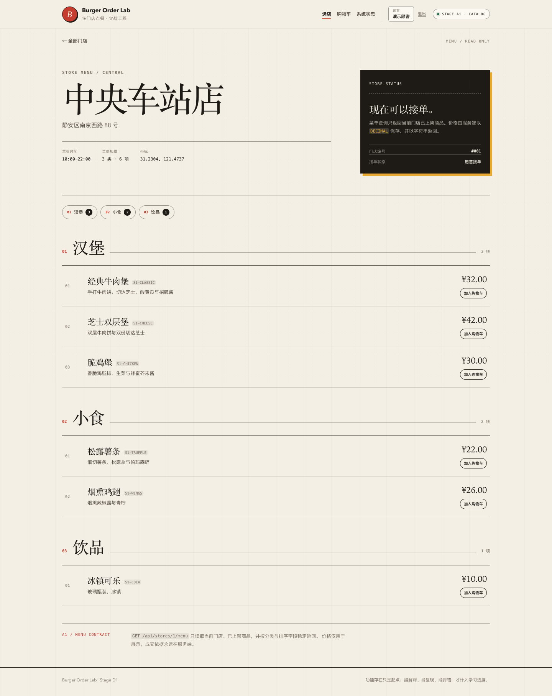

# 阶段 D1 实际验证记录

验证时间：2026-11-09 22:56–23:10（Asia/Shanghai）
范围：多阶段镜像、Nginx 反代、Compose app profile、部署验证、CI YAML。
只对应本机实际结果，不代表生产环境。

## 1. 镜像构建

```text
burger-order-lab-backend:latest   581MB
burger-order-lab-frontend:latest  76.6MB
```

后端：

```text
maven:3.9-eclipse-temurin-21 -> package
eclipse-temurin:21-jre-jammy -> non-root app + curl
```

前端：

```text
node:24-alpine -> pnpm build
nginx:1.27-alpine -> dist + nginx.conf
```

Docker 环境无 buildx 插件，使用 classic builder；构建成功。

## 2. Compose

`docker compose --profile app config` 解析出：

```text
backend, frontend, mysql, redis
```

端口：

```text
backend  127.0.0.1:18080 -> 8080
frontend 127.0.0.1:18081 -> 80
```

## 3. 运行状态

```text
burger-order-lab-backend-1   Up (healthy)
burger-order-lab-frontend-1  Up (healthy)
burger-order-lab-mysql-1     Up (healthy)
burger-order-lab-redis-1     Up (healthy)
```

验证脚本：

```text
deployment verification passed: frontend=18081 backend=18080
```

## 4. 容器 E2E

```text
D1 browser smoke passed: containerized frontend + nginx proxy + session login
```

验证：

- 容器前端 `/stores/1` 菜单；
- Nginx `/api` 反代；
- 容器后端 Session 登录；
- 页面无本页 JS 异常。

## 5. 页面截图



## 6. CI

`.github/workflows/ci.yml`：

- backend：Java 21 + Testcontainers 测试；
- frontend：Node 22 + pnpm 12.11.2 + typecheck/test/build；
- images：直接 `docker build` 两个上下文（避免 Compose 对 `.env` 插值的伪失败）。

YAML 已本地解析，**未在远程 GitHub Actions 执行**，不能宣称 CI 已绿。

## 7. 实际发现与修复

- CI images job 最初用 `docker compose --profile app build`，在无 `.env` 的 runner 会因 `${MYSQL_PASSWORD:?}` 插值失败；改为直接 `docker build`。
- Docker 环境无 buildx，classic builder 可用；多架构/高级 secrets 不验证。
- 容器前端截图最初页脚 C3，更新为 D1 后重建镜像并重拍。
- 没有编造镜像扫描/签名/registry 结果。

## 8. 已验证与未验证

### 已验证

- 后端/前端镜像构建；
- Compose 四服务健康；
- Nginx 反代 `/api`；
- 容器内登录/菜单；
- 部署/验证脚本；
- CI YAML 结构。

### 未验证

- 远程 GitHub Actions 执行；
- 镜像仓库 push/GHCR；
- 镜像签名、SBOM、漏洞扫描；
- 多架构镜像；
- Kubernetes/云部署；
- TLS/生产域名；
- 滚动升级/回滚。

## 9. 复现

```bash
./scripts/deploy-local.sh
./scripts/verify-deploy.sh
cd frontend && E2E_BASE_URL=http://127.0.0.1:18081 pnpm test:e2e:d1
```
